<div align="center">


# PetHaven

**Hospitalización canina y felina con amor de hogar — porque son familia**

[](https://openjdk.org)
[](https://spring.io/projects/spring-boot)
[](https://angular.dev)
[](https://primeng.org)
[](https://rxjs.dev)
[](https://www.h2database.com)
[](https://maven.apache.org)
[](LICENSE)

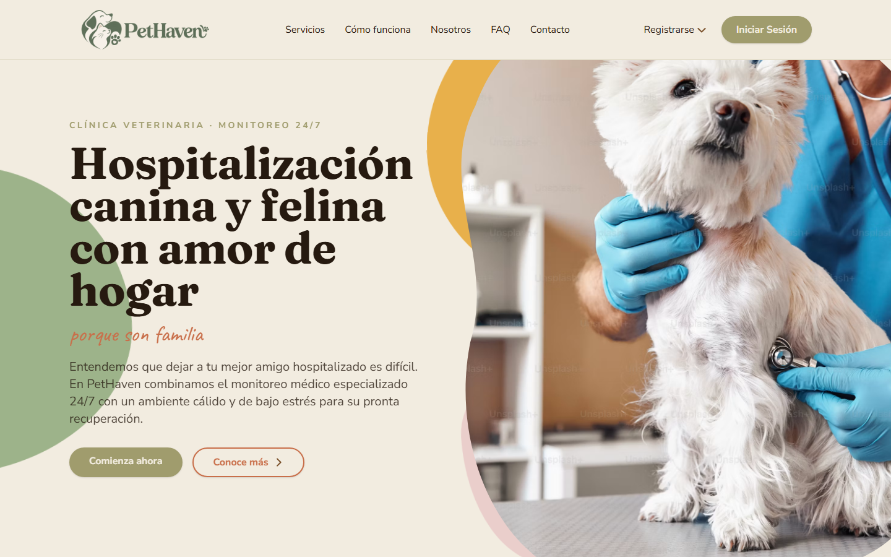

</div>

---

## Sobre PetHaven

PetHaven es una clínica veterinaria especializada en la **hospitalización de perros y gatos** que necesitan reposo y tratamiento dentro de sus instalaciones. Sus pacientes se quedan varios días bajo cuidado constante, mientras los veterinarios administran tratamientos hasta su recuperación.

Hasta ahora, buena parte de la operación vivía en papel y en hojas de Excel: el inventario de drogas, las atenciones médicas y el seguimiento de cada paciente. Este proyecto digitaliza ese negocio con una plataforma web que conecta a **tres tipos de usuario**:

| Rol | Qué puede hacer |
|---|---|
| **Cliente** (dueño) | Iniciar sesión, ver sus mascotas hospitalizadas en formato de tarjeta, consultar el detalle de cada una con su historial de tratamientos y revisar su perfil |
| **Veterinario** | Iniciar sesión, registrar dueños y mascotas, llevar el historial de atenciones, administrar tratamientos con descuento de inventario, consultar el inventario de medicamentos (solo lectura), dar de alta a las mascotas y descargar su historia clínica en PDF |
| **Administrador** | Iniciar sesión, gestionar el equipo de veterinarios (crear, editar, activar y desactivar), consultar las mascotas, gestionar el inventario de medicamentos (crear, editar, eliminar e importar desde Excel) y analizar los KPIs del negocio: tratamientos del mes, mascotas, veterinarios, ventas, ganancias y medicamentos más usados |

**El flujo del negocio:**

1. El dueño llega por primera vez y deja sus datos personales (cédula, nombre, correo, celular).
2. El veterinario registra a la mascota: nombre, raza, edad, peso, enfermedad y foto.
3. La mascota queda hospitalizada mientras recibe tratamientos.
4. Al recuperarse y ser recogida, la mascota pasa a estado **inactivo** — su historial nunca se borra.

**Arquitectura actual:** el backend Spring Boot expone toda la operación como **API REST** y el frontend **Angular + PrimeNG + RxJS** consume esa API como una SPA ([ver diagrama de arquitectura](docs/architecture/Diagrama-Arquitectura.png)). El acceso está protegido con **Spring Security**: un único login entrega un token JWT, las contraseñas se guardan con BCrypt y cada rol solo llega a sus operaciones y a sus propios recursos. Las antiguas vistas Thymeleaf ya fueron retiradas; el avance por entrega está en [Roadmap y estado del proyecto](#roadmap-y-estado-del-proyecto).

---

## Roadmap y estado del proyecto

El avance se organiza según las entregas del enunciado. Cada funcionalidad indica su cobertura en el backend y en el frontend, además del estado real de implementación.

**Leyenda:**

| Símbolo | Significado |
|---|---|
| ✅ | Implementado |
| 🟡 | Parcial |
| ⬜ | Pendiente |
| ➖ | No aplica |

**Resumen de avance:**

| Entrega | Completas | Parciales | Pendientes | Estado general |
|---|---|---|---|---|
| 1 | 7 | 0 | 0 | Completada |
| 2 | 6 | 0 | 0 | Completada |
| 3 | 2 | 0 | 1 | En progreso |

### Entrega 1 — Features 1 a 7

| Feature · AC | Funcionalidad | Detalle | Backend | Frontend | Estado |
|---|---|---|---|---|---|
| F01 · AC1–AC5 | Diseño | Diagramas de clases y entidad-relación, mockups navegables, logo y paleta de colores | ➖ | ➖ | Completado — entregables en `docs/` |
| F02 · AC6–AC8 | Repositorio | Repositorio público, ramas `main` y `desarrollo`, y README del proyecto | ➖ | ➖ | Completado |
| F03 · AC9–AC11 | Base de datos | Entidades JPA, repositorios Spring Data y datos de prueba | ✅ | ➖ | Backend completo; el frontend consume los datos vía API |
| F04 · AC12 | Landing page | Sitio promocional con navegación hacia los portales | ➖ | ✅ | Completado |
| F05 · AC13–AC14 | Portal del cliente | Login, mascotas en tarjetas, detalle e historial de tratamientos | ✅ | ✅ | Completado |
| F06 · AC15–AC19 | CRUD de dueños | Acceso del veterinario y CRUD con eliminación en cascada | ✅ | ✅ | Completado |
| F07 · AC20–AC24 | CRUD de mascotas | Crear, leer, actualizar, buscar y activar/desactivar | ✅ | ✅ | Completado |

### Entrega 2 — Features 8 a 11 + SPA

> El enunciado numera dos funcionalidades distintas como Feature 09; aquí se separan como F09-A (dashboard) y F09-B (carga de medicamentos).

| Feature · AC | Funcionalidad | Detalle | Backend | Frontend | Estado |
|---|---|---|---|---|---|
| F08 · AC25–AC28 | Portal de administración | Acceso del administrador y CRUD de veterinarios | ✅ | ✅ | Completado — login con rol `ADMIN`, CRUD de veterinarios y consulta de mascotas; la autorización por rol y el JWT llegaron con F13 |
| F09-A · AC29 | Dashboard de KPIs | Métricas de tratamientos, veterinarios, mascotas, ventas y ganancias | ✅ | ✅ | Completado — `GET /api/administrators/dashboard` y pantalla `/administrador/dashboard` |
| F09-B · AC30 | Carga de medicamentos | Importación del inventario desde Excel al iniciar | ✅ | ✅ | Completado — carga inicial al arrancar y, además, importación desde el portal del administrador en `/administrador/medicamentos/import` |
| F10 · AC31–AC32 | Tratamientos | Registrar tratamiento, descontar stock y listar mascotas tratadas por veterinario | ✅ | ✅ | Completado — registro con stock y filtro «Mis pacientes» en el listado de mascotas del veterinario |
| F11 · AC33 | Historial médico | Lista de tratamientos por mascota | ✅ | ✅ | Completado — visible en la ficha de la mascota |
| E2 · SPA | SPA en Angular | Frontend Angular consumiendo la API REST | ✅ | ✅ | Completado — portales de cliente, veterinario y administrador |

### Entrega 3 — Feature 13 + pruebas

| Feature · AC | Funcionalidad | Detalle | Backend | Frontend | Estado |
|---|---|---|---|---|---|
| F13 · AC34 | Control de acceso por roles | Autorización según el rol del usuario | ✅ | ✅ | Completado — Spring Security con login único, token JWT de 2 horas y contraseñas BCrypt; matriz de permisos por rol y por recurso propio (ver [Permisos](docs/api/API.md#permisos)); en la SPA, sesión en `localStorage`, interceptor del token y guards por portal |
| E3 · Pruebas cliente | Pruebas del cliente web | Al menos 2 casos de uso automatizados | ➖ | ✅ | Implementado — 2 casos E2E con Selenium WebDriver que recorren la SPA en Chrome contra el API real. Ver [Pruebas E2E](#pruebas-e2e) |
| E3 · Pruebas backend | Pruebas de backend | 25 pruebas con datos propios y limpieza posterior | ✅ | ➖ | Implementado — 970 pruebas (913 unitarias y 57 de integración) sobre repositorios, servicios y controladores, cada una con sus propios datos y limpieza posterior. Ver [Pruebas del backend](#pruebas-del-backend) |

### Extras fuera del enunciado

Estas funcionalidades no están exigidas por el enunciado, pero ya forman parte del producto:

| Funcionalidad | Detalle | Backend | Frontend | Estado |
|---|---|---|---|---|
| Perfil del cliente | Consulta de datos personales desde el portal del cliente | ✅ | ✅ | Completado |
| Perfil del veterinario | Datos y especialidad del veterinario autenticado | ✅ | ✅ | Completado |
| Importación de medicamentos desde Excel | El administrador sube un `.xlsx`/`.xls` (hasta 10 MB, arrastrando o seleccionando; hay plantilla descargable) y ve el resumen de la importación mediante `POST /api/drugs/import` | ✅ | ✅ | Completado — `/administrador/medicamentos/import` |
| Gestión de medicamentos por el administrador | Listado con búsqueda y filtro por stock, detalle, creación, edición y eliminación (el API rechaza con 409 los medicamentos con tratamientos asociados) | ✅ | ✅ | Completado — pestaña «Medicamentos» en el sidebar del administrador |
| Consulta de medicamentos por el veterinario | Listado y detalle de solo lectura del inventario, sin crear, editar, eliminar ni importar | ✅ | ✅ | Completado — `/veterinario/medicamentos` |
| Evolución y diagnóstico por consulta | Cada tratamiento registra peso, diagnóstico, evolución (`STABLE`, `IMPROVING`, `WORSENING`) y notas; el ingreso va sin evolución | ✅ | ✅ | Completado |
| Alta de mascotas | `POST /api/pets/{id}/discharge` deja a la mascota estable y registra el alta (`RECOVERED`) en su historia | ✅ | ✅ | Completado |
| Historia clínica en PDF | El veterinario ve la historia clínica de la mascota y la descarga en PDF (jsPDF) | ➖ | ✅ | Completado — `/veterinario/mascotas/:id/historia` |
| Foto de mascota vía API | `GET /api/pets/{id}/photo` sirve la foto desde el backend para poder incluirla en el PDF | ✅ | ✅ | Completado |
| Consulta de mascotas por el administrador | Listado de solo lectura de las mascotas desde el portal del administrador; activarlas o desactivarlas es tarea del veterinario | ✅ | ✅ | Completado |

---

## Capturas

Una mirada al estado actual de la aplicación, con datos de prueba.

<table>
  <tr>
    <td width="50%" valign="top">
      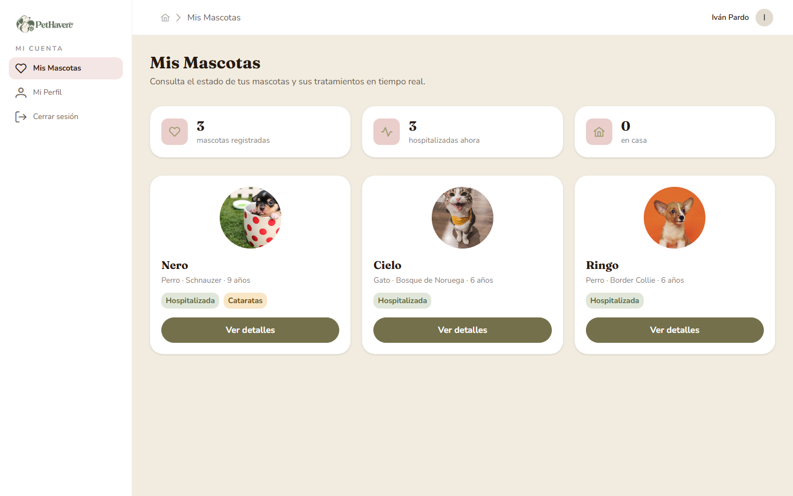
      <br>
      <sub><strong>Portal del cliente · F05.</strong> Mascotas, estado y acceso al historial.</sub>
    </td>
    <td width="50%" valign="top">
      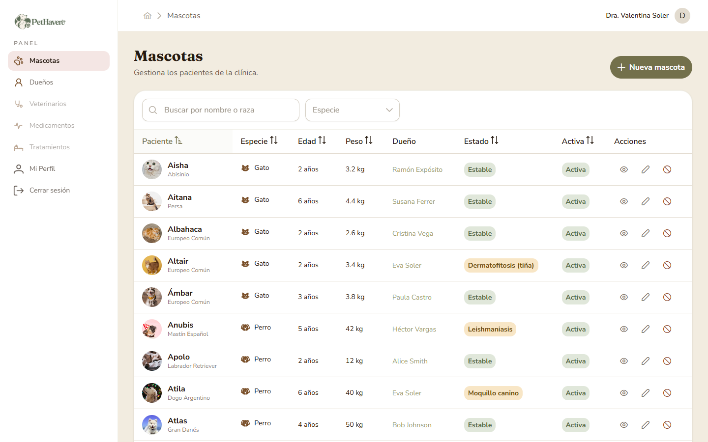
      <br>
      <sub><strong>Gestión de mascotas · F07.</strong> Búsqueda, filtros, paginación y estado.</sub>
    </td>
  </tr>
  <tr>
    <td width="50%" valign="top">
      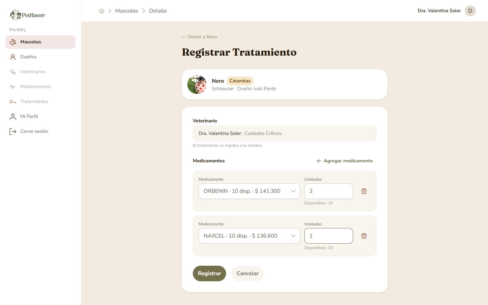
      <br>
      <sub><strong>Registrar tratamiento · F10.</strong> Medicamentos, stock y total.</sub>
    </td>
    <td width="50%" valign="top">
      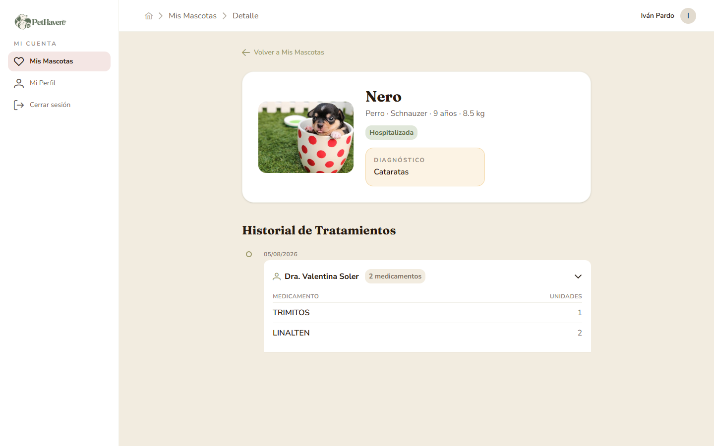
      <br>
      <sub><strong>Historial médico · F11.</strong> Línea de tiempo de tratamientos por mascota.</sub>
    </td>
  </tr>
  <tr>
    <td width="50%" valign="top">
      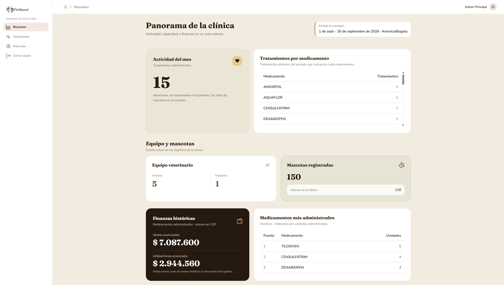
      <br>
      <sub><strong>Dashboard del administrador · F09.</strong> Tratamientos del mes, equipo, mascotas, ventas y ganancias.</sub>
    </td>
    <td width="50%" valign="top">
      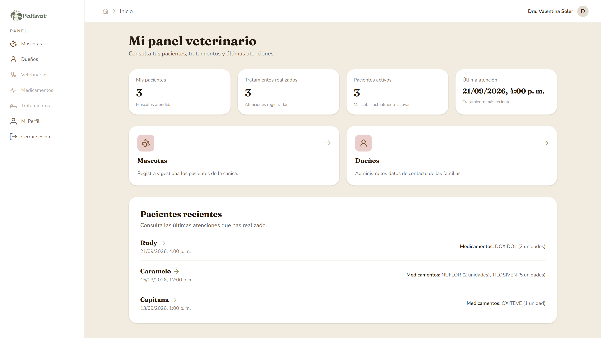
      <br>
      <sub><strong>Panel del veterinario · F10.</strong> Pacientes, tratamientos realizados y atenciones recientes.</sub>
    </td>
  </tr>
</table>

---

## Stack tecnológico

### Backend

| Capa | Tecnología |
|---|---|
| Lenguaje | Java 21 |
| Framework | Spring Boot 4.1 — API REST, Data JPA, Validation, DevTools |
| Objetivo | API REST para el frontend Angular |
| Base de datos | H2 en modo archivo, con consola de administración web |
| Importación | Apache POI 5.5.1 — lectura de medicamentos desde Excel (`.xlsx`/`.xls`) |
| Archivos | Carga multipart de hasta 10 MB (`POST /api/drugs/import`) |
| Seguridad | Spring Security 7 — login único con token JWT (jjwt 0.13, 2 horas, sin refresco), contraseñas BCrypt, autorización por rol y por recurso propio (`@PreAuthorize`) |
| CORS | Orígenes de `CORS_ALLOWED_ORIGINS` (por defecto `http://localhost:4200`), sin credenciales |
| Utilidades | Lombok |
| Pruebas | JUnit 5, Mockito, AssertJ y MockMvc; Surefire (unitarias) y Failsafe (integración); JaCoCo con un mínimo de 80% de líneas en `service` y `controller`; Selenium 4 y WebDriverManager para las pruebas E2E |
| Build | Maven Wrapper |

### Frontend (`frontend/`)

| Capa | Tecnología |
|---|---|
| Framework | Angular 19 — componentes standalone y lazy loading |
| UI | PrimeNG 19 con tema propio de PetHaven + Tailwind CSS 4 |
| API | `HttpClient` + RxJS, con URL base desde `environments/` |
| Sesión | Token JWT en `localStorage`, interceptor que lo añade a las peticiones al API, guards por rol y cierre de sesión al expirar o con un `401` |
| Reactividad | RxJS 7.8 + signals |
| PDF | jsPDF 4 — descarga de la historia clínica de la mascota |
| Lenguaje | TypeScript 5.7 |
| Tooling | Angular CLI + npm — requiere Node `^18.19.1 \|\| ^20.11.1 \|\| >=22` |

---

## Estructura del proyecto

```
pethaven/
├── docs/
│   ├── api/                       # Contrato de la API y ejemplos de peticiones
│   ├── architecture/              # Diagramas de arquitectura, dominio y entidad-relación
│   ├── design/                    # Logo e identidad de marca
│   ├── screenshots/               # Capturas para este README
│   └── Enunciado_Veterinaria.pdf  # Definición del negocio y requerimientos
│
├── frontend/                      # Frontend Angular 19
│   ├── public/                    # Imágenes, íconos, videos y plantilla de Excel de medicamentos
│   └── src/
│       ├── app/
│       │   ├── core/              # URL del API, sesión (interceptor y guards), errores HTTP, notificaciones y utilidades
│       │   ├── models/            # Interfaces de dominio (mascota, dueño, medicamento…)
│       │   ├── pages/
│       │   │   ├── landing/       # Landing page (secciones + directivas de animación)
│       │   │   ├── auth/          # Login único para los tres roles
│       │   │   ├── cliente/       # Portal del cliente: mascotas, detalle y perfil
│       │   │   ├── veterinario/   # Portal del veterinario: inicio, perfil, mascotas, tratamientos, historia clínica, dueños y consulta de medicamentos
│       │   │   ├── administrador/ # Portal del administrador: dashboard de KPIs, veterinarios, mascotas y medicamentos
│       │   │   └── shared/        # Layout compartido, páginas "coming soon" y pantallas de medicamentos
│       │   ├── services/          # Servicios HTTP por recurso
│       │   ├── theme/             # Preset PrimeNG de la marca
│       │   ├── app.config.ts      # Providers, locale es-CO y tema
│       │   └── app.routes.ts      # Rutas de la SPA
│       ├── environments/          # URL del API para desarrollo y producción
│       ├── styles.css             # Tailwind CSS y estilos globales
│       └── main.ts                # Punto de entrada
│
├── src/main/java/io/github/pethaven/   # Backend Spring Boot
│   ├── config/                    # Configuración de OpenAPI
│   ├── controller/                # Controladores REST (/api/**)
│   ├── dto/                       # Requests y responses de la API
│   ├── mapper/                    # Conversión entidad ↔ DTO
│   ├── service/                   # Lógica de negocio e importación de Excel
│   ├── repository/                # Repositorios Spring Data JPA (y proyecciones de los KPIs)
│   ├── entity/                    # Entidades JPA: Owner, Pet, Species, Treatment, Evolution, TreatmentDrug, Drug, Veterinarian, Administrator, UserEntity (cuenta de login) y Role
│   ├── exception/                 # Manejo global de errores
│   ├── security/                  # Spring Security: login y JWT, matriz de permisos, comprobación de recursos propios, roles y primer administrador, protección SSRF
│   ├── DataLoader.java            # Datos de prueba (dueños, mascotas, veterinarios, administradores y tratamientos) cargados al arrancar
│   ├── ExcelDrugImportRunner.java # Importación de medicamentos desde Excel al arrancar
│   └── PethavenBackendApplication.java
│
├── src/main/resources/
│   ├── data/medicamentos-veterinaria.xlsx  # Inventario importado al arrancar
│   └── application.properties     # Configuración (datasource, JPA, H2, CORS, JWT y primer administrador)
│
└── pom.xml
```

---

## Primeros pasos

### Requisitos previos

- **JDK 21** o superior — backend
- **Node.js** `^18.19.1 || ^20.11.1 || >=22` — frontend
- **Git** (para clonar el repositorio)
- No necesitas Maven instalado: el proyecto incluye el *Maven Wrapper*

### Backend

```bash
# 1. Clona el repositorio
git clone https://github.com/JoythDev/pethaven.git
cd pethaven

# 2. Arranca la aplicación
./mvnw spring-boot:run        # en Windows: .\mvnw.cmd spring-boot:run
```

En cada arranque la base de datos H2 se recrea y se puebla automáticamente (`ddl-auto=create-drop`). Antes de cargar los datos de ejemplo, la aplicación importa los medicamentos de `src/main/resources/data/medicamentos-veterinaria.xlsx`; si el archivo no es válido, no se importa ninguno y el error queda en el log. La API queda en **<http://localhost:8080/api>**, con documentación interactiva en **<http://localhost:8080/swagger-ui.html>**.

### Frontend

```bash
cd frontend
npm install
npm start
```

La SPA queda en **<http://localhost:4200>** y consume la API desde `http://localhost:8080/api`, así que el backend debe estar encendido. La URL base se configura en `frontend/src/environments/environment.ts` (y `environment.production.ts` para el build de producción).

### Variables de entorno de seguridad

En desarrollo no hace falta definir ninguna: todas tienen un valor por defecto. Fuera de desarrollo se definen siempre, porque la clave JWT por defecto está en el repositorio.

| Variable | Por defecto | Uso |
|---|---|---|
| `JWT_SECRET` | Clave de desarrollo | Clave HMAC en Base64 (mínimo 256 bits) que firma los tokens. Cambiarla cierra todas las sesiones |
| `JWT_EXPIRATION_MS` | `7200000` (2 horas) | Vigencia del token |
| `CORS_ALLOWED_ORIGINS` | `http://localhost:4200` | Orígenes del frontend, separados por comas |
| `ADMIN_EMAIL`, `ADMIN_PASSWORD`, `ADMIN_NAME` | *(vacías)*, `Administrador` | Primer administrador: se crea al arrancar solo si no existe ninguno y están definidos el correo y la contraseña |

El detalle está en [Configuración de seguridad](docs/api/API.md#configuración-de-seguridad).

### Credenciales de prueba

Puedes iniciar sesión con cualquiera de los usuarios precargados:

| Rol | Correo | Contraseña |
|---|---|---|
| Cliente | `john.doe@example.com` | `password123` |
| Veterinario | `valentina.soler@pethaven.com` | `vet12345` |
| Administrador | `admin@pethaven.com` | `admin12345` |

Todos inician sesión en `/login` y cada uno entra al portal de su rol: el cliente a `/cliente`, el veterinario a `/veterinario` y el administrador a `/administrador`. También hay un veterinario inactivo (`julian.restrepo@pethaven.com`) para probar el rechazo de cuentas desactivadas.

### Consola de H2

La base de datos expone una consola web para explorar tablas y datos:

| Parámetro | Valor |
|---|---|
| URL | `http://localhost:8080/h2` |
| JDBC URL | `jdbc:h2:file:./pethaven-database` |
| Usuario | `sa` |
| Contraseña | *(vacía)* |

### Pruebas del backend

Las pruebas usan el perfil `test`: una base H2 en memoria que arranca vacía, sin los datos de ejemplo ni la importación del Excel. Nunca tocan la base `pethaven-database` del desarrollo.

```bash
./mvnw test      # solo pruebas unitarias (Surefire)
./mvnw verify    # unitarias + integración (Failsafe) + reporte y mínimo de cobertura (JaCoCo)
```

En Windows usa `.\mvnw.cmd` en lugar de `./mvnw`. Para correr una sola clase: `./mvnw test -Dtest=PetControllerTest`.

Estos comandos excluyen las pruebas E2E (marcadas con `@Tag("e2e")`), así que no necesitan el frontend ni Chrome. Las E2E se ejecutan aparte con el perfil `e2e`; ver [Pruebas E2E](#pruebas-e2e).

| Capa | Tipo de prueba | Clases |
|---|---|---|
| Repositorio | `@DataJpaTest` sobre H2 en memoria; cada prueba hace rollback | `*RepositoryTest` |
| Servicio | Unitarias con Mockito y los mappers reales | `*ServiceMockTest`, `ExcelReadingServiceTest` |
| Servicio | Integración con `@SpringBootTest`: transacciones, stock e importación real del Excel | `*IntegrationTest` |
| Controlador | `@WebMvcTest` con MockMvc y servicios simulados: rutas, códigos HTTP, validación y JSON de error | `*ControllerTest`, `GlobalExceptionHandlerTest` |
| Seguridad | JWT, login, primer administrador, CORS y errores `401`/`403`; matriz de permisos por rol con `@WebMvcTest` y recursos propios contra la base real | `security/**`, `PermissionMatrixWebTest`, `OwnershipAccessIntegrationTest` |

`./mvnw verify` falla si la cobertura de líneas de los paquetes `service` o `controller` baja de 80%. El reporte HTML queda en `target/site/jacoco/index.html`. Para ver el reporte sin que el mínimo detenga el build: `./mvnw verify -Djacoco.haltOnFailure=false`.

### Pruebas E2E

Dos casos de uso automatizados con Selenium WebDriver recorren la SPA en Chrome contra el API real (`src/test/java/io/github/pethaven/e2e/`). Cada caso arranca el backend con el perfil `test` en el puerto 8080 y reinicia el contexto antes de cada prueba (`@DirtiesContext`), por lo que parte siempre de los mismos datos mínimos que carga `DatabaseInit` (un veterinario, un administrador, un dueño con su mascota y un medicamento).

| Caso | Flujo |
|---|---|
| `Case1Test` | El veterinario inicia sesión (falla una vez con contraseña errada), registra un dueño (se equivoca una vez con el correo) y su mascota; luego el dueño entra al portal de clientes y ve la mascota en su tarjeta |
| `Case2Test` | El veterinario busca una mascota, abre su ficha y registra un tratamiento con un medicamento; vuelve a buscarla para verificar el historial, y el administrador comprueba en el dashboard las unidades suministradas, las ventas y la ganancia |

**Requisitos:** Chrome instalado (WebDriverManager descarga el driver), el frontend corriendo con `npm start` en `http://localhost:4200` y el puerto 8080 libre.

```bash
# Terminal 1: frontend
cd frontend && npm start

# Terminal 2: pruebas E2E (el backend lo levanta la propia prueba)
./mvnw test -Pe2e                        # ambos casos, con el navegador visible
./mvnw test -Pe2e -Dtest=Case1Test       # un solo caso
./mvnw test -Pe2e -De2e.headless=true    # sin ventana (CI), a 1920×1080
```

El perfil `e2e` ejecuta solo las clases con `@Tag("e2e")` y omite las pruebas de integración y JaCoCo: las E2E no cuentan para el mínimo de cobertura. Sin `-Pe2e`, `-Dtest=Case1Test` termina en BUILD SUCCESS sin ejecutar ninguna prueba, porque las E2E están excluidas por defecto.

En Windows usa `.\mvnw.cmd`. Para localizar los elementos, las plantillas Angular tienen `id` y clases estables (`btnLogin`, `btnGuardar`, `pet-name`, `owner-document`…).

---

## Rutas disponibles

### Backend — API REST (`http://localhost:8080`)

Los recursos viven bajo `/api/**`: `auth`, `owners`, `pets`, `veterinarians`, `drugs`, `treatments` y `administrators` (KPIs del dashboard). Todos exigen el token del login (`Authorization: Bearer <token>`) salvo `POST /api/auth/login`, y cada rol tiene sus permisos ([matriz de permisos](docs/api/API.md#permisos)). El contrato está en [docs/api/API.md](docs/api/API.md), hay ejemplos ejecutables en [docs/api/pethaven.http](docs/api/pethaven.http) y la documentación interactiva en `http://localhost:8080/swagger-ui.html`.

### Frontend — SPA Angular (`http://localhost:4200`)

| Ruta | Descripción |
|---|---|
| `/` | Landing page |
| `/login` | Inicio de sesión único: lleva a cada usuario al portal de su rol |
| `/cliente` | Entrada del cliente: resuelve su id y lo lleva a sus mascotas |
| `/cliente/:ownerId/mascotas` | Mascotas del cliente |
| `/cliente/:ownerId/mascotas/:petId` | Detalle de una mascota |
| `/cliente/:ownerId/perfil` | Perfil del cliente |
| `/veterinario` | Inicio del portal veterinario |
| `/veterinario/perfil` | Perfil del veterinario |
| `/veterinario/mascotas` | Listado de mascotas |
| `/veterinario/mascotas/add` | Registrar una mascota |
| `/veterinario/mascotas/update/:id` | Editar una mascota |
| `/veterinario/mascotas/:id` | Detalle de una mascota e historial de tratamientos |
| `/veterinario/mascotas/:id/historia` | Historia clínica de la mascota, con descarga en PDF |
| `/veterinario/mascotas/:id/treatments/add` | Registrar un tratamiento |
| `/veterinario/duenos` | Listado de dueños |
| `/veterinario/duenos/add` | Registrar un dueño |
| `/veterinario/duenos/update/:id` | Editar un dueño |
| `/veterinario/duenos/:id` | Detalle de un dueño y sus mascotas |
| `/veterinario/medicamentos` | Consulta del inventario de medicamentos (solo lectura) |
| `/veterinario/medicamentos/:id` | Detalle de un medicamento (solo lectura) |
| `/administrador` | Portal del administrador: redirige a `/administrador/dashboard` |
| `/administrador/dashboard` | Resumen de KPIs del negocio |
| `/administrador/veterinarios` | Listado de veterinarios, con activación y desactivación |
| `/administrador/veterinarios/add` | Registrar un veterinario |
| `/administrador/veterinarios/update/:id` | Editar un veterinario |
| `/administrador/mascotas` | Listado de mascotas (solo consulta) |
| `/administrador/medicamentos` | Inventario de medicamentos, con búsqueda y filtro por stock |
| `/administrador/medicamentos/add` | Registrar un medicamento |
| `/administrador/medicamentos/update/:id` | Editar un medicamento |
| `/administrador/medicamentos/import` | Importar medicamentos desde un archivo Excel |
| `/administrador/medicamentos/:id` | Detalle de un medicamento, con opción de eliminarlo |
| `/dashboard` | Redirección legacy al portal veterinario |
| `/veterinario/pets`, `/veterinario/owners`, `/veterinario/drugs` | Rutas anteriores: redirigen a `mascotas`, `duenos` y `medicamentos` |

> Cada portal tiene un guard de rol: sin sesión, o con la sesión de otro rol, la SPA lleva al login o al portal propio. El dueño solo entra a su propio `:ownerId`. Aun así, quien decide es el API: un recurso ajeno responde `403` y la pantalla muestra el mensaje sin cerrar la sesión.

---

## Estrategia de ramas

El repositorio sigue el flujo definido en el enunciado del proyecto:

```
main (producción)          ← lo que ve y califica el cliente
 └── desarrollo            ← integración de los cambios del equipo
      └── feature/*        ← una rama por funcionalidad
```

Los cambios se integran primero en `desarrollo`; solo cuando todo está funcional se promueven a `main`.

---

## Documentación

El contrato de la API REST está en [docs/api/API.md](docs/api/API.md), con ejemplos de peticiones en [docs/api/pethaven.http](docs/api/pethaven.http).

Los diagramas de `docs/architecture` se mantienen en Figma y se exportan aquí. Incluyen la capa de seguridad: cuentas de login (`users`), roles (`roles`, `user_roles`), Spring Security y JWT.

<details>
<summary><b>Identidad de marca</b></summary>
<br/>
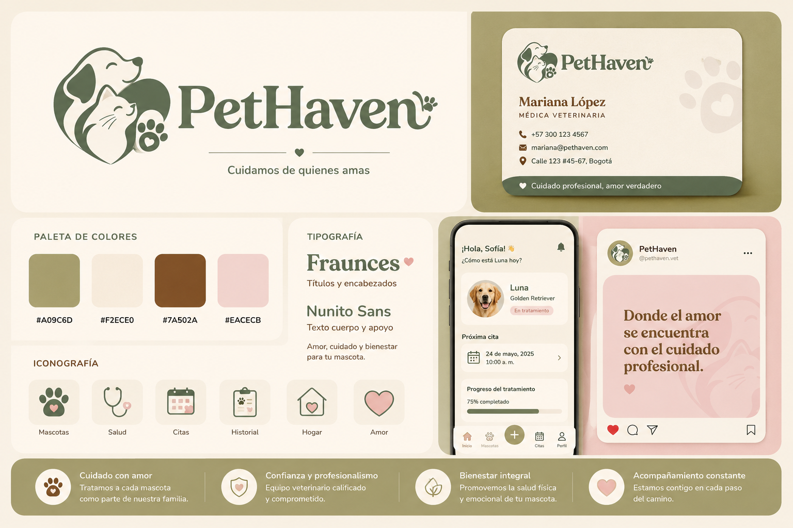
</details>

<details>
<summary><b>Diagrama entidad-relación</b></summary>
<br/>
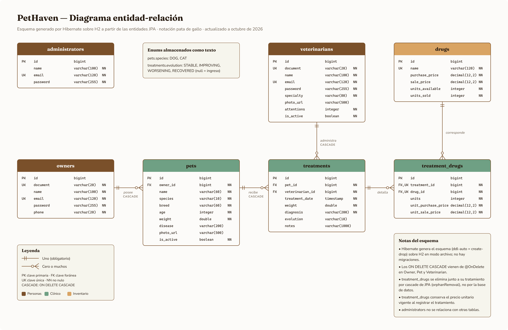
</details>

<details>
<summary><b>Diagrama de clases del dominio</b></summary>
<br/>
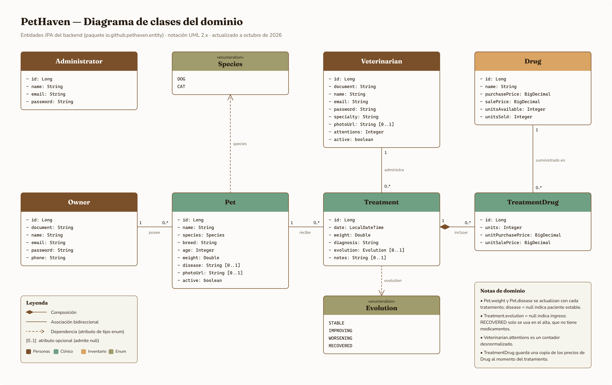
</details>

<details>
<summary><b>Diagrama de arquitectura</b></summary>
<br/>
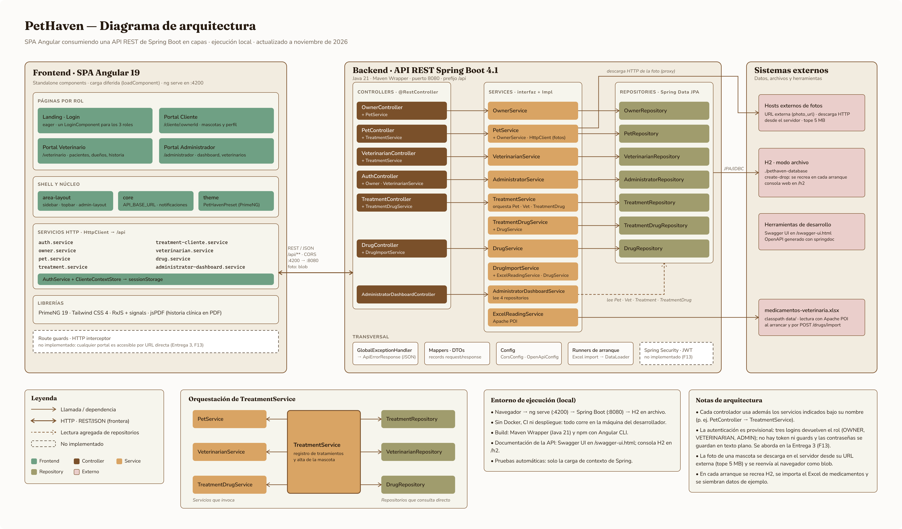
</details>

<details>
<summary><b>Enunciado del proyecto</b></summary>
<br/>
La definición completa del negocio, los requerimientos y las entregas se encuentra en <a href="docs/Enunciado_Veterinaria.pdf">docs/Enunciado_Veterinaria.pdf</a>.
</details>

---

## Equipo

| Integrante      | GitHub                                              |
|-----------------|-----------------------------------------------------|
| Ángel García    | [DeluxeMovie](https://github.com/DeluxeMovie)       |
| Juliana Pacheco | [JuliiPa](https://github.com/JuliiPa)               |
| Manuel Rincon   | [ManuelRincon90](https://github.com/ManuelRincon90) |
| Nicolás Joya    | [JoythDev](https://github.com/JoythDev)             |

---

## Licencia

Este proyecto se distribuye bajo la [Licencia MIT](LICENSE).
