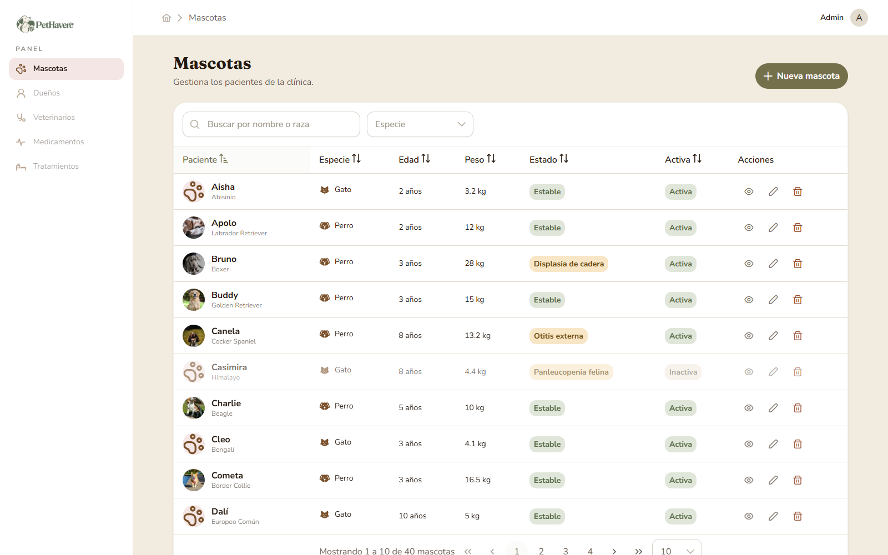
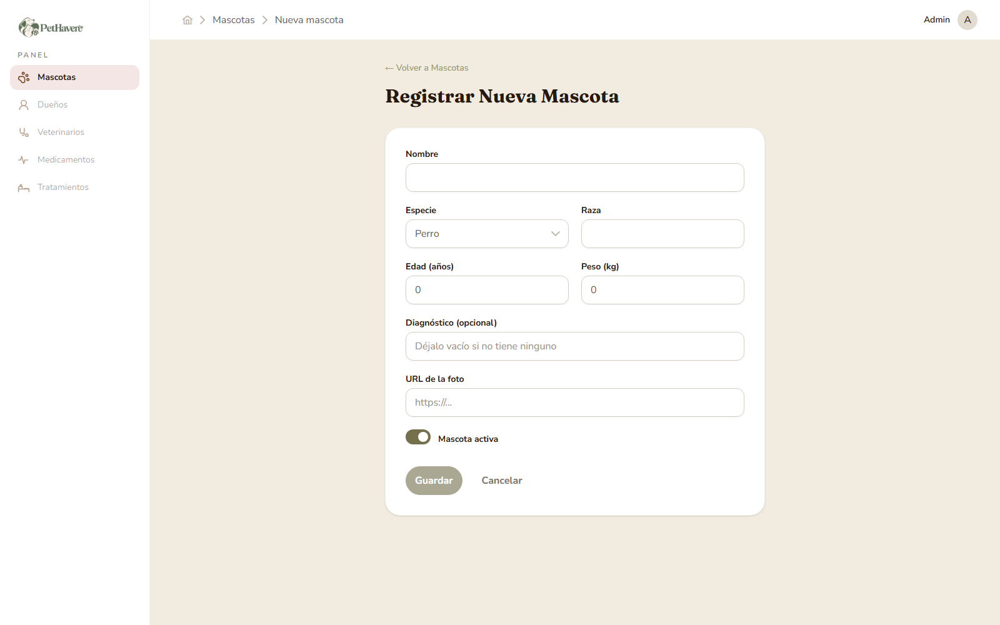

<div align="center">


# PetHaven

**Hospitalización canina y felina con amor de hogar — porque son familia**

[](https://openjdk.org)
[](https://spring.io/projects/spring-boot)
[](https://angular.dev)
[](https://primeng.org)
[](https://rxjs.dev)
[](https://www.h2database.com)
[](https://maven.apache.org)
[](LICENSE)


</div>

---

## Sobre PetHaven

PetHaven es una clínica veterinaria especializada en la **hospitalización de perros y gatos** que necesitan reposo y tratamiento dentro de sus instalaciones. Sus pacientes se quedan varios días bajo cuidado constante, mientras los veterinarios administran tratamientos hasta su recuperación.

Hasta ahora, buena parte de la operación vivía en papel y en hojas de Excel: el inventario de drogas, las atenciones médicas y el seguimiento de cada paciente. Este proyecto digitaliza ese negocio con una plataforma web que conecta a **tres tipos de usuario**:

| Rol | Qué puede hacer |
|---|---|
| **Cliente** (dueño) | Iniciar sesión, ver sus mascotas hospitalizadas en formato de tarjeta, consultar el detalle de cada una y revisar su perfil |
| **Veterinario** | Iniciar sesión, registrar dueños y mascotas, llevar el historial de atenciones y administrar tratamientos con descuento de inventario |
| **Administrador** | Gestionar el equipo de veterinarios y analizar los KPIs del negocio: mascotas en tratamiento, atenciones realizadas, ventas y ganancias *(en desarrollo)* |

**El flujo del negocio:**

1. El dueño llega por primera vez y deja sus datos personales (cédula, nombre, correo, celular).
2. El veterinario registra a la mascota: nombre, raza, edad, peso, enfermedad y foto.
3. La mascota queda hospitalizada mientras recibe tratamientos.
4. Al recuperarse y ser recogida, la mascota pasa a estado **inactivo** — su historial nunca se borra.

**Arquitectura actual:** el backend Spring Boot expone toda la operación como **API REST** y el frontend **Angular + PrimeNG + RxJS** consume esa API como una SPA. Las antiguas vistas Thymeleaf ya fueron retiradas; el detalle y lo que falta está en [Estado de la migración](#estado-de-la-migración).

---

## Estado de la migración

La migración dejó atrás el renderizado en el servidor: un solo frontend Angular (SPA) consume una API REST del backend.

| Pieza | Estado |
|---|---|
| Backend (`src/`) | **API REST completa** — incluye dueños, mascotas, veterinarios, medicamentos y tratamientos, autenticación provisional e importación de medicamentos desde Excel |
| Frontend (`frontend/`) | **SPA Angular integrada a la API** — portales de cliente y veterinario con `HttpClient` + RxJS |

**Fases:**

- [x] **Demo funcional** — landing portada a Angular y primeros módulos de mascotas y dueños sobre datos de prueba en memoria. Fue la base del frontend actual.
- [x] **API REST** — todos los recursos del backend expuestos como API REST bajo `/api/**`, documentados con Swagger.
- [x] **Integración SPA** — el frontend consume la API con `HttpClient` + RxJS, con login de dueño y veterinario, portales por rol y configuración por entorno.
- [ ] **Módulos restantes** — portal de administración, dashboard de KPIs y pantalla de medicamentos. Veterinarios, tratamientos e historial ya están implementados.
- [x] **Retiro de Thymeleaf** — vistas de servidor y MVC legacy eliminados del repositorio.

<div align="center">
  
  <br/>
  <sub>Módulo de mascotas — listado con búsqueda, filtro por especie y paginación (Angular + PrimeNG)</sub>
  <br/><br/>
  
  <br/>
  <sub>Registro de una mascota — formulario del portal veterinario</sub>
</div>

---

## Funcionalidades

### Implementadas — Entrega 1 (Features 1 a 7)

- [x] **Feature 01 — Diseño**: nombre, logo, paleta de colores y mockups navegables diferenciados por tipo de usuario
- [x] **Feature 02 — Repositorio**: GitHub público con ramas de `desarrollo` y `main` (producción)
- [x] **Feature 03 — Base de datos**: entidades JPA, repositorios Spring Data y datos de prueba que simulan el funcionamiento real
- [x] **Feature 04 — Landing page**: sitio promocional de la clínica con navegación hacia los portales
- [x] **Feature 05 — Portal cliente**: inicio de sesión y consulta de mascotas en tarjetas con su detalle
- [x] **Feature 06 — CRUD de dueños**: crear, consultar, actualizar y eliminar (con eliminación en cascada de sus mascotas)
- [x] **Feature 07 — CRUD de mascotas**: crear, consultar, actualizar y activar/desactivar

### Frontend Angular (SPA integrada)

- [x] Landing page portada a Angular, fiel a la versión Thymeleaf (secciones + directivas de animación)
- [x] Login de dueño y veterinario contra la API, con sesión en `sessionStorage` y redirección según el rol
- [x] Portal del cliente: mascotas en tarjetas, detalle de cada mascota y perfil
- [x] Portal del veterinario con layout propio (sidebar y topbar) e inicio
- [x] Módulo de mascotas: listado con búsqueda por nombre o raza, filtro por especie y paginación (PrimeNG Table)
- [x] Detalle, registro y edición de mascotas, con activar/desactivar
- [x] Módulo de dueños: listado con búsqueda por nombre o documento y paginación; ficha con sus mascotas; registro, edición y eliminación en cascada
- [x] Vínculo mascota ↔ dueño: selector de dueño en el formulario de mascota, columna «Dueño» en el listado y navegación entre fichas
- [x] Tratamientos: registro con uno o más medicamentos, descuento automático del stock e historial en la ficha de la mascota
- [x] Perfil del veterinario con sus datos y especialidad
- [ ] Pantalla de medicamentos: catálogo e importación desde Excel (el backend ya expone ambos)
- [ ] Portal de administración y dashboard de KPIs

> El frontend consume la API en `http://localhost:8080/api`, así que el backend debe estar encendido. Ver [Estado de la migración](#estado-de-la-migración).

### Roadmap

**Entrega 1**

| Funcionalidad | Detalle | Estado |
|---|---|---|
| Búsqueda de mascotas | Buscar una mascota por nombre y mostrar su información junto con la de su dueño (AC21) | Hecho — el listado filtra por nombre o raza y muestra el dueño |

**Entrega 2 (Features 8 a 11)**

| Funcionalidad | Detalle | Estado |
|---|---|---|
| Portal de administración | Registrar, actualizar y activar/desactivar veterinarios (Feature 08) | Backend listo — UI de administración pendiente |
| Dashboard de KPIs | Mascotas en tratamiento, atenciones, ventas, ganancias y top de tratamientos más vendidos (Feature 09) | Pendiente |
| Carga de medicamentos | Importar el inventario de drogas desde un archivo al iniciar el programa (Feature 09) | Hecho — importación al arrancar y endpoint `POST /api/drugs/import` |
| Tratamientos | Administrar una droga a una mascota y descontar el inventario disponible (Feature 10) | Hecho |
| Historial médico | Consultar la lista de tratamientos dados a cada mascota (Feature 11) | Hecho |
| SPA en Angular | Frontend Angular consumiendo la API REST | Hecho — portales de cliente y veterinario |

**Entrega 3**

| Funcionalidad | Detalle |
|---|---|
| Control de acceso por roles | Restringir cada funcionalidad según el rol del usuario (Feature 13) |
| Pruebas del cliente web | Al menos 2 casos de uso automatizados |
| Pruebas de backend | 25 pruebas automatizadas que cargan y limpian sus propios datos de prueba |

---

## Stack tecnológico

### Backend

| Capa | Tecnología |
|---|---|
| Lenguaje | Java 21 |
| Framework | Spring Boot 4.1 — API REST, Data JPA, Validation, DevTools |
| Objetivo | API REST para el frontend Angular |
| Base de datos | H2 en modo archivo, con consola de administración web |
| Importación | Apache POI 5.5.1 — lectura de medicamentos desde Excel (`.xlsx`/`.xls`) |
| Archivos | Carga multipart de hasta 10 MB (`POST /api/drugs/import`) |
| Autenticación | Provisional — login de dueño y veterinario, sin token ni roles |
| CORS | Origen permitido: `http://localhost:4200` |
| Utilidades | Lombok |
| Build | Maven Wrapper |

### Frontend (`frontend/`)

| Capa | Tecnología |
|---|---|
| Framework | Angular 19 — componentes standalone y lazy loading |
| UI | PrimeNG 19 con tema propio de PetHaven + Tailwind CSS 4 |
| API | `HttpClient` + RxJS, con URL base desde `environments/` |
| Reactividad | RxJS 7.8 + signals |
| Lenguaje | TypeScript 5.7 |
| Tooling | Angular CLI + npm — requiere Node `^18.19.1 \|\| ^20.11.1 \|\| >=22` |

---

## Estructura del proyecto

```
pethaven/
├── docs/
│   ├── api/                       # Contrato de la API y ejemplos de peticiones
│   ├── architecture/              # Diagramas de dominio y entidad-relación
│   ├── design/                    # Logo e identidad de marca
│   ├── screenshots/               # Capturas para este README
│   └── Enunciado_Veterinaria.pdf  # Definición del negocio y requerimientos
│
├── frontend/                      # Frontend Angular 19
│   ├── public/                    # Imágenes, íconos y videos
│   └── src/
│       ├── app/
│       │   ├── core/              # URL del API, errores HTTP, notificaciones y utilidades
│       │   ├── models/            # Interfaces de dominio (mascota, dueño, medicamento…)
│       │   ├── pages/
│       │   │   ├── landing/       # Landing page (secciones + directivas de animación)
│       │   │   ├── auth/          # Login de dueño y veterinario
│       │   │   ├── cliente/       # Portal del cliente: mascotas, detalle y perfil
│       │   │   ├── veterinario/   # Portal del veterinario: inicio, perfil, mascotas, tratamientos y dueños
│       │   │   └── shared/        # Layout compartido y páginas "coming soon"
│       │   ├── services/          # Servicios HTTP por recurso
│       │   ├── theme/             # Preset PrimeNG de la marca
│       │   ├── app.config.ts      # Providers, locale es-CO y tema
│       │   └── app.routes.ts      # Rutas de la SPA
│       ├── environments/          # URL del API para desarrollo y producción
│       ├── styles.css             # Tailwind CSS y estilos globales
│       └── main.ts                # Punto de entrada
│
├── src/main/java/io/github/pethaven/   # Backend Spring Boot
│   ├── config/                    # CORS y configuración de OpenAPI
│   ├── controller/                # Controladores REST (/api/**)
│   ├── dto/                       # Requests y responses de la API
│   ├── mapper/                    # Conversión entidad ↔ DTO
│   ├── service/                   # Lógica de negocio e importación de Excel
│   ├── repository/                # Repositorios Spring Data JPA
│   ├── entity/                    # Entidades JPA: Owner, Pet, Species, Treatment, TreatmentDrug, Drug, Veterinarian
│   ├── exception/                 # Manejo global de errores
│   ├── DataLoader.java            # Datos de prueba cargados al arrancar
│   ├── ExcelDrugImportRunner.java # Importación de medicamentos desde Excel al arrancar
│   └── PethavenBackendApplication.java
│
├── src/main/resources/
│   ├── data/medicamentos-veterinaria.xlsx  # Inventario importado al arrancar
│   └── application.properties     # Configuración (datasource, JPA, H2, CORS)
│
└── pom.xml
```

---

## Primeros pasos

### Requisitos previos

- **JDK 21** o superior — backend
- **Node.js** `^18.19.1 || ^20.11.1 || >=22` — frontend
- **Git** (para clonar el repositorio)
- No necesitas Maven instalado: el proyecto incluye el *Maven Wrapper*

### Backend

```bash
# 1. Clona el repositorio
git clone https://github.com/JoythDev/pethaven.git
cd pethaven

# 2. Arranca la aplicación
./mvnw spring-boot:run        # en Windows: .\mvnw.cmd spring-boot:run
```

En cada arranque la base de datos H2 se recrea y se puebla automáticamente (`ddl-auto=create-drop`). Antes de cargar los datos de ejemplo, la aplicación importa los medicamentos de `src/main/resources/data/medicamentos-veterinaria.xlsx`; si el archivo no es válido, no se importa ninguno y el error queda en el log. La API queda en **<http://localhost:8080/api>**, con documentación interactiva en **<http://localhost:8080/swagger-ui.html>**.

### Frontend

```bash
cd frontend
npm install
npm start
```

La SPA queda en **<http://localhost:4200>** y consume la API desde `http://localhost:8080/api`, así que el backend debe estar encendido. La URL base se configura en `frontend/src/environments/environment.ts` (y `environment.production.ts` para el build de producción).

### Credenciales de prueba

Puedes iniciar sesión con cualquiera de los usuarios precargados:

| Rol | Correo | Contraseña |
|---|---|---|
| Cliente | `john.doe@example.com` | `password123` |
| Veterinario | `valentina.soler@pethaven.com` | `vet12345` |

El cliente entra a `/cliente` y el veterinario a `/veterinario`. También hay un veterinario inactivo (`julian.restrepo@pethaven.com`) para probar el rechazo de cuentas desactivadas.

### Consola de H2

La base de datos expone una consola web para explorar tablas y datos:

| Parámetro | Valor |
|---|---|
| URL | `http://localhost:8080/h2` |
| JDBC URL | `jdbc:h2:file:./pethaven-database` |
| Usuario | `sa` |
| Contraseña | *(vacía)* |

---

## Rutas disponibles

### Backend — API REST (`http://localhost:8080`)

Los recursos viven bajo `/api/**`: `auth`, `owners`, `pets`, `veterinarians`, `drugs` y `treatments`. El contrato está en [docs/api/API.md](docs/api/API.md), hay ejemplos ejecutables en [docs/api/pethaven.http](docs/api/pethaven.http) y la documentación interactiva en `http://localhost:8080/swagger-ui.html`.

### Frontend — SPA Angular (`http://localhost:4200`)

| Ruta | Descripción |
|---|---|
| `/` | Landing page |
| `/login` | Inicio de sesión de clientes |
| `/vet/login` | Inicio de sesión de veterinarios |
| `/cliente` | Entrada del cliente: resuelve su id y lo lleva a sus mascotas |
| `/cliente/:ownerId/mascotas` | Mascotas del cliente |
| `/cliente/:ownerId/mascotas/:petId` | Detalle de una mascota |
| `/cliente/:ownerId/perfil` | Perfil del cliente |
| `/veterinario` | Inicio del portal veterinario |
| `/veterinario/perfil` | Perfil del veterinario |
| `/veterinario/pets` | Listado de mascotas |
| `/veterinario/pets/add` | Registrar una mascota |
| `/veterinario/pets/update/:id` | Editar una mascota |
| `/veterinario/pets/:id` | Detalle de una mascota e historial de tratamientos |
| `/veterinario/pets/:id/treatments/add` | Registrar un tratamiento |
| `/veterinario/owners` | Listado de dueños |
| `/veterinario/owners/add` | Registrar un dueño |
| `/veterinario/owners/update/:id` | Editar un dueño |
| `/veterinario/owners/:id` | Detalle de un dueño y sus mascotas |
| `/administrador` | Portal del administrador (en preparación) |
| `/dashboard` | Redirección legacy al portal veterinario |

> La autenticación es provisional: la sesión se guarda en `sessionStorage` y todavía no hay token ni guards de rol.

---

## Estrategia de ramas

El repositorio sigue el flujo definido en el enunciado del proyecto:

```
main (producción)          ← lo que ve y califica el cliente
 └── desarrollo            ← integración de los cambios del equipo
      └── feature/*        ← una rama por funcionalidad
```

Los cambios se integran primero en `desarrollo`; solo cuando todo está funcional se promueven a `main`.

---

## Documentación

El contrato de la API REST está en [docs/api/API.md](docs/api/API.md), con ejemplos de peticiones en [docs/api/pethaven.http](docs/api/pethaven.http).

<details>
<summary><b>Identidad de marca</b></summary>
<br/>

</details>

<details>
<summary><b>Diagrama entidad-relación</b></summary>
<br/>

</details>

<details>
<summary><b>Diagrama de clases del dominio</b></summary>
<br/>

</details>

<details>
<summary><b>Enunciado del proyecto</b></summary>
<br/>
La definición completa del negocio, los requerimientos y las entregas se encuentra en <a href="docs/Enunciado_Veterinaria.pdf">docs/Enunciado_Veterinaria.pdf</a>.
</details>

---

## Equipo

| Integrante      | GitHub                                              |
|-----------------|-----------------------------------------------------|
| Ángel García    | [DeluxeMovie](https://github.com/DeluxeMovie)       |
| Juliana Pacheco | [JuliiPa](https://github.com/JuliiPa)               |
| Manuel Rincon   | [ManuelRincon90](https://github.com/ManuelRincon90) |
| Nicolás Joya    | [JoythDev](https://github.com/JoythDev)             |

---

## Licencia

Este proyecto se distribuye bajo la [Licencia MIT](LICENSE).
