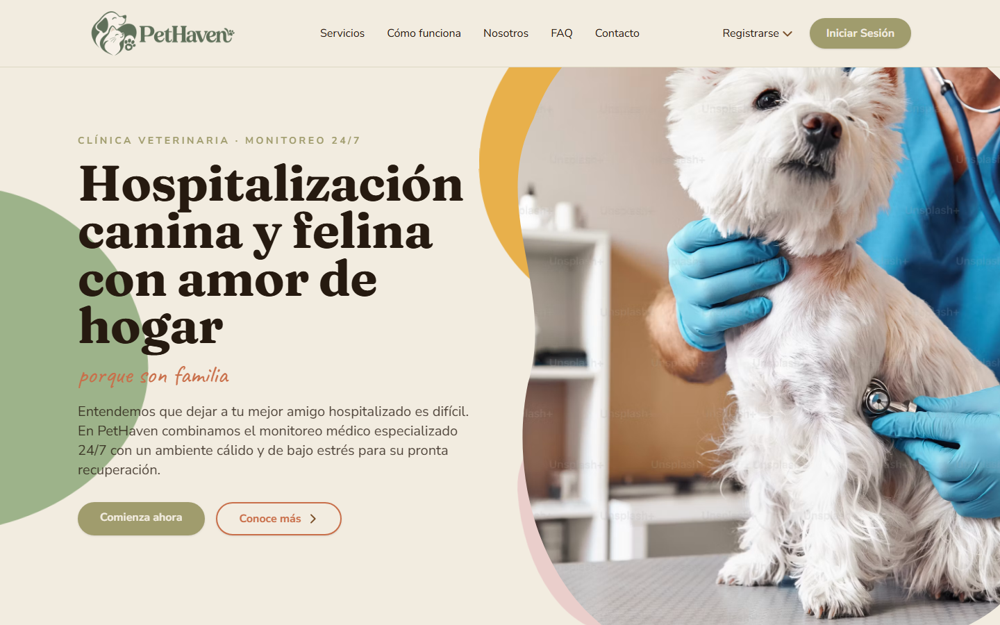
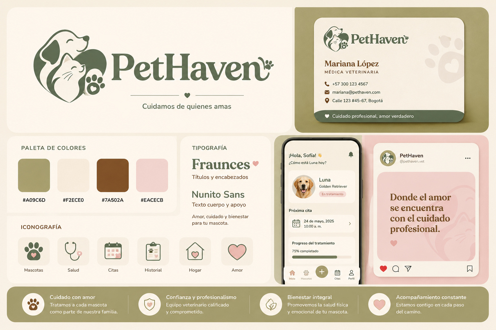
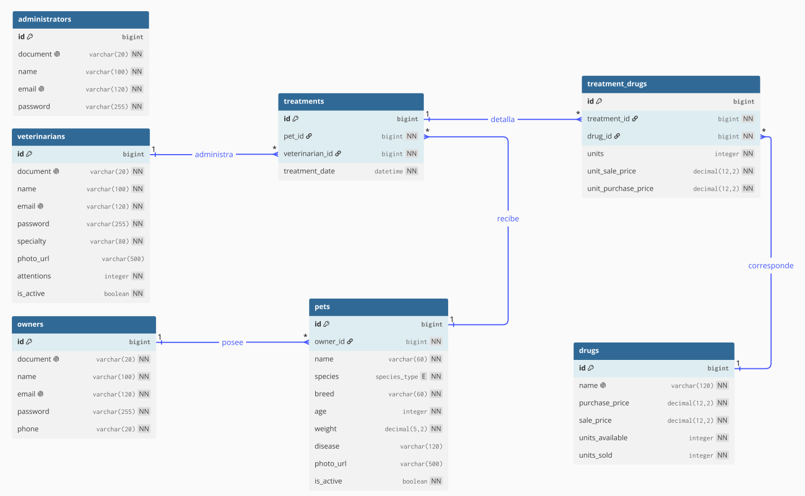
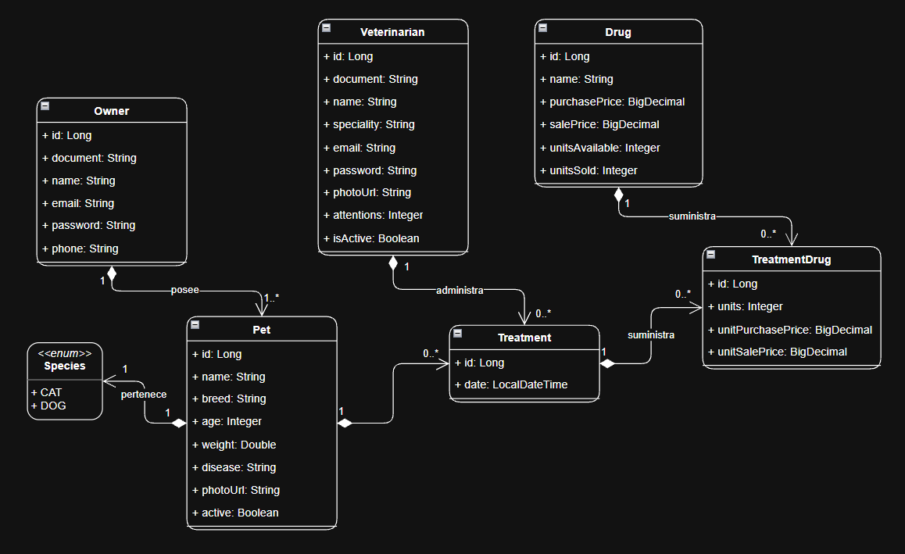

<div align="center">


# PetHaven

**Hospitalización canina y felina con amor de hogar — porque son familia**

[](https://openjdk.org)
[](https://spring.io/projects/spring-boot)
[](https://angular.dev)
[](https://primeng.org)
[](https://rxjs.dev)
[](https://www.h2database.com)
[](https://maven.apache.org)
[](LICENSE)



</div>

---

## Sobre PetHaven

PetHaven es una clínica veterinaria especializada en la **hospitalización de perros y gatos** que necesitan reposo y tratamiento dentro de sus instalaciones. Sus pacientes se quedan varios días bajo cuidado constante, mientras los veterinarios administran tratamientos hasta su recuperación.

Hasta ahora, buena parte de la operación vivía en papel y en hojas de Excel: el inventario de drogas, las atenciones médicas y el seguimiento de cada paciente. Este proyecto digitaliza ese negocio con una plataforma web que conecta a **tres tipos de usuario**:

| Rol | Qué puede hacer |
|---|---|
| **Cliente** (dueño) | Iniciar sesión, ver sus mascotas hospitalizadas en formato de tarjeta, consultar el detalle de cada una y revisar su perfil |
| **Veterinario** | Iniciar sesión, registrar dueños y mascotas, llevar el historial de atenciones y administrar tratamientos con descuento de inventario |
| **Administrador** | Gestionar el equipo de veterinarios y analizar los KPIs del negocio: mascotas en tratamiento, atenciones realizadas, ventas y ganancias *(en desarrollo)* |

**El flujo del negocio:**

1. El dueño llega por primera vez y deja sus datos personales (cédula, nombre, correo, celular).
2. El veterinario registra a la mascota: nombre, raza, edad, peso, enfermedad y foto.
3. La mascota queda hospitalizada mientras recibe tratamientos.
4. Al recuperarse y ser recogida, la mascota pasa a estado **inactivo** — su historial nunca se borra.

**Arquitectura actual:** el backend Spring Boot expone toda la operación como **API REST** y el frontend **Angular + PrimeNG + RxJS** consume esa API como una SPA. Las antiguas vistas Thymeleaf ya fueron retiradas; el avance por entrega está en [Roadmap y estado del proyecto](#roadmap-y-estado-del-proyecto).

---

## Roadmap y estado del proyecto

El avance se organiza según las entregas del enunciado. Cada funcionalidad indica su cobertura en el backend y en el frontend, además del estado real de implementación.

**Leyenda:**

| Símbolo | Significado |
|---|---|
| ✅ | Implementado |
| 🟡 | Parcial |
| ⬜ | Pendiente |
| ➖ | No aplica |

**Resumen de avance:**

| Entrega | Completas | Parciales | Pendientes | Estado general |
|---|---|---|---|---|
| 1 | 7 | 0 | 0 | Completada |
| 2 | 2 | 3 | 1 | En progreso |
| 3 | 0 | 1 | 2 | Pendiente |

### Entrega 1 — Features 1 a 7

| Feature · AC | Funcionalidad | Detalle | Backend | Frontend | Estado |
|---|---|---|---|---|---|
| F01 · AC1–AC5 | Diseño | Diagramas de clases y entidad-relación, mockups navegables, logo y paleta de colores | ➖ | ➖ | Completado — entregables en `docs/` |
| F02 · AC6–AC8 | Repositorio | Repositorio público, ramas `main` y `desarrollo`, y README del proyecto | ➖ | ➖ | Completado |
| F03 · AC9–AC11 | Base de datos | Entidades JPA, repositorios Spring Data y datos de prueba | ✅ | ➖ | Backend completo; el frontend consume los datos vía API |
| F04 · AC12 | Landing page | Sitio promocional con navegación hacia los portales | ➖ | ✅ | Completado |
| F05 · AC13–AC14 | Portal del cliente | Login, mascotas en tarjetas, detalle e historial de tratamientos | ✅ | ✅ | Completado |
| F06 · AC15–AC19 | CRUD de dueños | Acceso del veterinario y CRUD con eliminación en cascada | ✅ | ✅ | Completado |
| F07 · AC20–AC24 | CRUD de mascotas | Crear, leer, actualizar, buscar y activar/desactivar | ✅ | ✅ | Completado |

### Entrega 2 — Features 8 a 11 + SPA

> El enunciado numera dos funcionalidades distintas como Feature 09; aquí se separan como F09-A (dashboard) y F09-B (carga de medicamentos).

| Feature · AC | Funcionalidad | Detalle | Backend | Frontend | Estado |
|---|---|---|---|---|---|
| F08 · AC25–AC28 | Portal de administración | Acceso del administrador y CRUD de veterinarios | 🟡 | ⬜ | Parcial — CRUD de veterinarios en la API; faltan autenticación/rol de administrador y UI |
| F09-A · AC29 | Dashboard de KPIs | Métricas de tratamientos, veterinarios, mascotas, ventas y ganancias | ⬜ | ⬜ | Pendiente — sin endpoints ni pantalla |
| F09-B · AC30 | Carga de medicamentos | Importación del inventario desde Excel al iniciar | ✅ | ➖ | Completo en backend; el enunciado no exige interfaz |
| F10 · AC31–AC32 | Tratamientos | Registrar tratamiento, descontar stock y listar mascotas tratadas por veterinario | ✅ | 🟡 | Parcial — registro y stock completos; falta la vista de mascotas tratadas |
| F11 · AC33 | Historial médico | Lista de tratamientos por mascota | ✅ | ✅ | Completado — visible en la ficha de la mascota |
| E2 · SPA | SPA en Angular | Frontend Angular consumiendo la API REST | ✅ | 🟡 | Parcial — portales de cliente y veterinario; faltan administración y KPIs |

### Entrega 3 — Feature 13 + pruebas

| Feature · AC | Funcionalidad | Detalle | Backend | Frontend | Estado |
|---|---|---|---|---|---|
| F13 · AC34 | Control de acceso por roles | Autorización según el rol del usuario | 🟡 | ⬜ | Parcial — el login devuelve el rol; no hay token ni guards de autorización |
| E3 · Pruebas cliente | Pruebas del cliente web | Al menos 2 casos de uso automatizados | ➖ | ⬜ | Pendiente — no hay specs de cliente |
| E3 · Pruebas backend | Pruebas de backend | 25 pruebas con datos propios y limpieza posterior | ⬜ | ➖ | Pendiente — solo existe la prueba de contexto |

### Extras fuera del enunciado

Estas funcionalidades no están exigidas por el enunciado, pero ya forman parte del producto:

| Funcionalidad | Detalle | Backend | Frontend | Estado |
|---|---|---|---|---|
| Perfil del cliente | Consulta de datos personales desde el portal del cliente | ✅ | ✅ | Completado |
| Perfil del veterinario | Datos y especialidad del veterinario autenticado | ✅ | ✅ | Completado |
| Importación por endpoint | Carga de medicamentos desde un archivo mediante `POST /api/drugs/import` | ✅ | ➖ | Backend completo |
| CRUD de medicamentos | Listado, creación, actualización y eliminación de medicamentos | ✅ | ⬜ | Backend completo; sin pantalla |

---

## Stack tecnológico

### Backend

| Capa | Tecnología |
|---|---|
| Lenguaje | Java 21 |
| Framework | Spring Boot 4.1 — API REST, Data JPA, Validation, DevTools |
| Objetivo | API REST para el frontend Angular |
| Base de datos | H2 en modo archivo, con consola de administración web |
| Importación | Apache POI 5.5.1 — lectura de medicamentos desde Excel (`.xlsx`/`.xls`) |
| Archivos | Carga multipart de hasta 10 MB (`POST /api/drugs/import`) |
| Autenticación | Provisional — login de dueño y veterinario, sin token ni roles |
| CORS | Origen permitido: `http://localhost:4200` |
| Utilidades | Lombok |
| Build | Maven Wrapper |

### Frontend (`frontend/`)

| Capa | Tecnología |
|---|---|
| Framework | Angular 19 — componentes standalone y lazy loading |
| UI | PrimeNG 19 con tema propio de PetHaven + Tailwind CSS 4 |
| API | `HttpClient` + RxJS, con URL base desde `environments/` |
| Reactividad | RxJS 7.8 + signals |
| Lenguaje | TypeScript 5.7 |
| Tooling | Angular CLI + npm — requiere Node `^18.19.1 \|\| ^20.11.1 \|\| >=22` |

---

## Estructura del proyecto

```
pethaven/
├── docs/
│   ├── api/                       # Contrato de la API y ejemplos de peticiones
│   ├── architecture/              # Diagramas de dominio y entidad-relación
│   ├── design/                    # Logo e identidad de marca
│   ├── screenshots/               # Capturas para este README
│   └── Enunciado_Veterinaria.pdf  # Definición del negocio y requerimientos
│
├── frontend/                      # Frontend Angular 19
│   ├── public/                    # Imágenes, íconos y videos
│   └── src/
│       ├── app/
│       │   ├── core/              # URL del API, errores HTTP, notificaciones y utilidades
│       │   ├── models/            # Interfaces de dominio (mascota, dueño, medicamento…)
│       │   ├── pages/
│       │   │   ├── landing/       # Landing page (secciones + directivas de animación)
│       │   │   ├── auth/          # Login de dueño y veterinario
│       │   │   ├── cliente/       # Portal del cliente: mascotas, detalle y perfil
│       │   │   ├── veterinario/   # Portal del veterinario: inicio, perfil, mascotas, tratamientos y dueños
│       │   │   └── shared/        # Layout compartido y páginas "coming soon"
│       │   ├── services/          # Servicios HTTP por recurso
│       │   ├── theme/             # Preset PrimeNG de la marca
│       │   ├── app.config.ts      # Providers, locale es-CO y tema
│       │   └── app.routes.ts      # Rutas de la SPA
│       ├── environments/          # URL del API para desarrollo y producción
│       ├── styles.css             # Tailwind CSS y estilos globales
│       └── main.ts                # Punto de entrada
│
├── src/main/java/io/github/pethaven/   # Backend Spring Boot
│   ├── config/                    # CORS y configuración de OpenAPI
│   ├── controller/                # Controladores REST (/api/**)
│   ├── dto/                       # Requests y responses de la API
│   ├── mapper/                    # Conversión entidad ↔ DTO
│   ├── service/                   # Lógica de negocio e importación de Excel
│   ├── repository/                # Repositorios Spring Data JPA
│   ├── entity/                    # Entidades JPA: Owner, Pet, Species, Treatment, TreatmentDrug, Drug, Veterinarian
│   ├── exception/                 # Manejo global de errores
│   ├── DataLoader.java            # Datos de prueba cargados al arrancar
│   ├── ExcelDrugImportRunner.java # Importación de medicamentos desde Excel al arrancar
│   └── PethavenBackendApplication.java
│
├── src/main/resources/
│   ├── data/medicamentos-veterinaria.xlsx  # Inventario importado al arrancar
│   └── application.properties     # Configuración (datasource, JPA, H2, CORS)
│
└── pom.xml
```

---

## Primeros pasos

### Requisitos previos

- **JDK 21** o superior — backend
- **Node.js** `^18.19.1 || ^20.11.1 || >=22` — frontend
- **Git** (para clonar el repositorio)
- No necesitas Maven instalado: el proyecto incluye el *Maven Wrapper*

### Backend

```bash
# 1. Clona el repositorio
git clone https://github.com/JoythDev/pethaven.git
cd pethaven

# 2. Arranca la aplicación
./mvnw spring-boot:run        # en Windows: .\mvnw.cmd spring-boot:run
```

En cada arranque la base de datos H2 se recrea y se puebla automáticamente (`ddl-auto=create-drop`). Antes de cargar los datos de ejemplo, la aplicación importa los medicamentos de `src/main/resources/data/medicamentos-veterinaria.xlsx`; si el archivo no es válido, no se importa ninguno y el error queda en el log. La API queda en **<http://localhost:8080/api>**, con documentación interactiva en **<http://localhost:8080/swagger-ui.html>**.

### Frontend

```bash
cd frontend
npm install
npm start
```

La SPA queda en **<http://localhost:4200>** y consume la API desde `http://localhost:8080/api`, así que el backend debe estar encendido. La URL base se configura en `frontend/src/environments/environment.ts` (y `environment.production.ts` para el build de producción).

### Credenciales de prueba

Puedes iniciar sesión con cualquiera de los usuarios precargados:

| Rol | Correo | Contraseña |
|---|---|---|
| Cliente | `john.doe@example.com` | `password123` |
| Veterinario | `valentina.soler@pethaven.com` | `vet12345` |

El cliente entra a `/cliente` y el veterinario a `/veterinario`. También hay un veterinario inactivo (`julian.restrepo@pethaven.com`) para probar el rechazo de cuentas desactivadas.

### Consola de H2

La base de datos expone una consola web para explorar tablas y datos:

| Parámetro | Valor |
|---|---|
| URL | `http://localhost:8080/h2` |
| JDBC URL | `jdbc:h2:file:./pethaven-database` |
| Usuario | `sa` |
| Contraseña | *(vacía)* |

---

## Rutas disponibles

### Backend — API REST (`http://localhost:8080`)

Los recursos viven bajo `/api/**`: `auth`, `owners`, `pets`, `veterinarians`, `drugs` y `treatments`. El contrato está en [docs/api/API.md](docs/api/API.md), hay ejemplos ejecutables en [docs/api/pethaven.http](docs/api/pethaven.http) y la documentación interactiva en `http://localhost:8080/swagger-ui.html`.

### Frontend — SPA Angular (`http://localhost:4200`)

| Ruta | Descripción |
|---|---|
| `/` | Landing page |
| `/login` | Inicio de sesión de clientes |
| `/vet/login` | Inicio de sesión de veterinarios |
| `/cliente` | Entrada del cliente: resuelve su id y lo lleva a sus mascotas |
| `/cliente/:ownerId/mascotas` | Mascotas del cliente |
| `/cliente/:ownerId/mascotas/:petId` | Detalle de una mascota |
| `/cliente/:ownerId/perfil` | Perfil del cliente |
| `/veterinario` | Inicio del portal veterinario |
| `/veterinario/perfil` | Perfil del veterinario |
| `/veterinario/pets` | Listado de mascotas |
| `/veterinario/pets/add` | Registrar una mascota |
| `/veterinario/pets/update/:id` | Editar una mascota |
| `/veterinario/pets/:id` | Detalle de una mascota e historial de tratamientos |
| `/veterinario/pets/:id/treatments/add` | Registrar un tratamiento |
| `/veterinario/owners` | Listado de dueños |
| `/veterinario/owners/add` | Registrar un dueño |
| `/veterinario/owners/update/:id` | Editar un dueño |
| `/veterinario/owners/:id` | Detalle de un dueño y sus mascotas |
| `/administrador` | Portal del administrador (en preparación) |
| `/dashboard` | Redirección legacy al portal veterinario |

> La autenticación es provisional: la sesión se guarda en `sessionStorage` y todavía no hay token ni guards de rol.

---

## Estrategia de ramas

El repositorio sigue el flujo definido en el enunciado del proyecto:

```
main (producción)          ← lo que ve y califica el cliente
 └── desarrollo            ← integración de los cambios del equipo
      └── feature/*        ← una rama por funcionalidad
```

Los cambios se integran primero en `desarrollo`; solo cuando todo está funcional se promueven a `main`.

---

## Documentación

El contrato de la API REST está en [docs/api/API.md](docs/api/API.md), con ejemplos de peticiones en [docs/api/pethaven.http](docs/api/pethaven.http).

<details>
<summary><b>Identidad de marca</b></summary>
<br/>

</details>

<details>
<summary><b>Diagrama entidad-relación</b></summary>
<br/>

</details>

<details>
<summary><b>Diagrama de clases del dominio</b></summary>
<br/>

</details>

<details>
<summary><b>Enunciado del proyecto</b></summary>
<br/>
La definición completa del negocio, los requerimientos y las entregas se encuentra en <a href="docs/Enunciado_Veterinaria.pdf">docs/Enunciado_Veterinaria.pdf</a>.
</details>

---

## Equipo

| Integrante      | GitHub                                              |
|-----------------|-----------------------------------------------------|
| Ángel García    | [DeluxeMovie](https://github.com/DeluxeMovie)       |
| Juliana Pacheco | [JuliiPa](https://github.com/JuliiPa)               |
| Manuel Rincon   | [ManuelRincon90](https://github.com/ManuelRincon90) |
| Nicolás Joya    | [JoythDev](https://github.com/JoythDev)             |

---

## Licencia

Este proyecto se distribuye bajo la [Licencia MIT](LICENSE).
