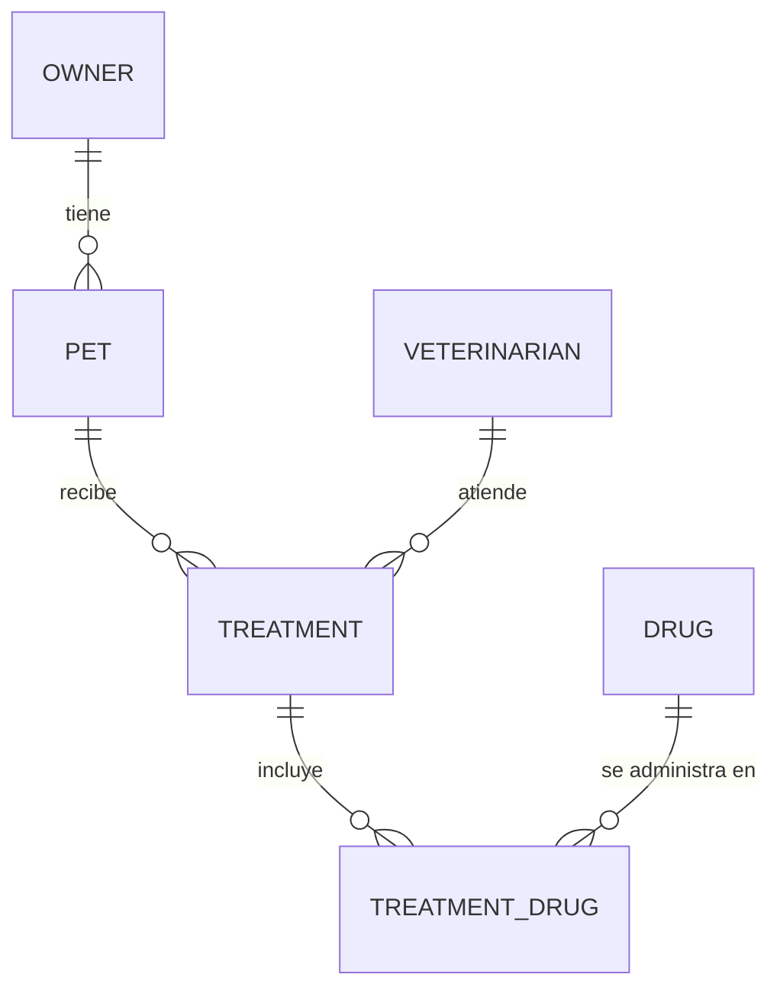

# API REST PetHaven

Referencia de la API REST de PetHaven: dueños, mascotas, veterinarios, medicamentos, tratamientos y autenticación provisional, bajo el prefijo `/api`.

**Enlaces:** [README del proyecto](../../README.md) · [Swagger UI](http://localhost:8080/swagger-ui.html) · [Colección de peticiones (pethaven.http)](./pethaven.http)

## Índice

- [Visión general](#visión-general)
- [Convenciones generales](#convenciones-generales)
- [Errores](#errores)
- [Modelo de datos](#modelo-de-datos)
- [Esquemas](#esquemas)
- [Endpoints](#endpoints)
  - [Dueños (`/api/owners`)](#dueños-apiowners)
  - [Mascotas (`/api/pets`)](#mascotas-apipets)
  - [Veterinarios (`/api/veterinarians`)](#veterinarios-apiveterinarians)
  - [Medicamentos (`/api/drugs`)](#medicamentos-apidrugs)
  - [Tratamientos (`/api/treatments`)](#tratamientos-apitreatments)
  - [Autenticación (`/api/auth`)](#autenticación-apiauth)
- [Reglas de negocio](#reglas-de-negocio)
- [Limitaciones y roadmap](#limitaciones-y-roadmap)
- [Apéndice: notas de implementación](#apéndice-notas-de-implementación)

## Visión general

Esta API expone la operación de la clínica veterinaria PetHaven (hospitalización de perros y gatos): los dueños y sus mascotas, el equipo de veterinarios, el inventario de medicamentos y el historial de tratamientos. Es una API REST con cuerpos JSON: el frontend es una SPA Angular que la consume, y **no hay renderizado en servidor**.

El backend está construido con **Spring Boot 4.1 sobre Java 21** (Spring Web, Spring Data JPA, Bean Validation) y persiste en una base **H2 en archivo**. La documentación interactiva la genera springdoc a partir de las anotaciones del código.

### Cómo levantar la API

```bash
# Windows (PowerShell)
.\mvnw.cmd spring-boot:run

# Linux / macOS
./mvnw spring-boot:run
```

Al arrancar, la base se crea y se puebla con datos de prueba; la API queda en el puerto **8080**.

| Recurso | URL | Notas |
|---|---|---|
| Base URL | `http://localhost:8080/api` | Todas las rutas de este documento son relativas a este prefijo |
| Swagger UI | `http://localhost:8080/swagger-ui.html` | «Try it out» habilitado; ordena operaciones por método y etiquetas alfabéticamente |
| Consola H2 | `http://localhost:8080/h2` | Solo desarrollo. JDBC URL `jdbc:h2:file:./pethaven-database`, usuario `sa`, contraseña vacía |
| SPA Angular | `http://localhost:4200` | Único origen permitido por CORS |

### Datos de prueba

El arranque carga datos de ejemplo: **100 dueños, 150 mascotas, 6 veterinarios (5 activos y 1 inactivo), 7 medicamentos y 15 tratamientos** repartidos desde el `2026-08-01`. Los tratamientos del seed ya descuentan inventario y suman atenciones, igual que lo hace la API, así que el stock y las unidades vendidas de un medicamento pueden ser menores que su valor inicial.

Como los id salen de una columna autoincremental en orden de inserción, son estables entre arranques: el dueño `31` es **Diego Aguilar**, el veterinario `1` es la **Dra. Valentina Soler** y el medicamento `1` es **Amoxicilina 250mg**.

Por el mismo motivo, los ejemplos de creación de este documento muestran los id `101` (dueño), `151` (mascota), `7` (veterinario), `8` (medicamento) y `16` (tratamiento): son los siguientes valores de cada tabla en una base recién poblada. Los importes de inventario y los contadores de atenciones, en cambio, dependen de los tratamientos que ya se hayan registrado.

Credenciales de demostración:

| Rol | Correo | Contraseña |
|---|---|---|
| Dueño | `john.doe@example.com` | `password123` |
| Veterinario | `valentina.soler@pethaven.com` | `vet12345` |

### Inicio rápido

Los tres ejemplos siguientes están escritos para bash/zsh; en PowerShell usa `curl.exe` y comillas dobles escapadas.

**1. Listar dueños**

```bash
curl http://localhost:8080/api/owners
```

Respuesta real (`200 OK`, la lista completa trae 100 elementos; se muestran los dos primeros):

```json
[
  {
    "id": 1,
    "document": "123456789",
    "name": "John Doe",
    "email": "john.doe@example.com",
    "phone": "1234567890"
  },
  {
    "id": 2,
    "document": "987654321",
    "name": "Jane Doe",
    "email": "jane.doe@example.com",
    "phone": "0987654321"
  }
]
```

**2. Crear un dueño**

```bash
curl -i -X POST http://localhost:8080/api/owners \
  -H "Content-Type: application/json" \
  -d '{"document":"990000001","name":"Nuevo Dueño","email":"nuevo.dueno@example.com","password":"password123","phone":"3000000000"}'
```

Respuesta real (`201 Created`; el id es `101` en una base recién poblada, porque el seed ya ocupa del 1 al 100):

```http
HTTP/1.1 201 Created
Location: http://localhost:8080/api/owners/101
Content-Type: application/json

{"id":101,"document":"990000001","name":"Nuevo Dueño","email":"nuevo.dueno@example.com","phone":"3000000000"}
```

**3. Iniciar sesión como dueño**

```bash
curl -i -X POST http://localhost:8080/api/auth/owners/login \
  -H "Content-Type: application/json" \
  -d '{"email":"john.doe@example.com","password":"password123"}'
```

Respuesta real (`200 OK`):

```json
{
  "id": 1,
  "name": "John Doe",
  "email": "john.doe@example.com",
  "role": "OWNER"
}
```

## Convenciones generales

| Tema | Regla |
|---|---|
| Base URL | `http://localhost:8080/api` |
| Formato | JSON con campos en `camelCase`; `Content-Type: application/json` en toda petición con cuerpo |
| Identificadores | `id` numéricos (`Long`); se generan en el servidor y no se envían al crear |
| Especie | `"DOG"` o `"CAT"` (cualquier otro valor es un `400`) |
| Booleanos | El nombre del campo es `active` (nunca `isActive`) |
| Fechas y horas | ISO-8601. Datos de negocio en hora local sin zona (`2026-08-05T10:30:00`); el `timestamp` de los errores va en UTC con sufijo `Z` |
| Contraseñas | Nunca aparecen en una respuesta. En actualizaciones son opcionales: omitir el campo o enviarlo en blanco conserva la contraseña actual |
| Creación | `201 Created` y cabecera `Location` con la URL absoluta del recurso creado. Excepción: `POST /api/treatments/{id}/drugs` responde `201` sin `Location` (no existe endpoint de detalle del renglón) |
| Eliminación | `204 No Content`, sin cuerpo |
| Actualización | `PUT` es reemplazo total de los campos editables; los campos que no viajan en la petición se conservan |
| Colecciones | Sin paginación, orden ni filtros genéricos: cada `GET` de colección devuelve todos los registros |
| CORS | Solo `http://localhost:4200`, sin credenciales; expone la cabecera `Location` |
| Autenticación | Provisional y sin token ni sesión: el resto de la API está abierta (ver [Autenticación](#autenticación-apiauth)) |
| Errores | Un único formato, `ApiErrorResponse`, para cualquier fallo (ver [Errores](#errores)) |

## Errores

Todas las respuestas de error comparten el cuerpo `ApiErrorResponse`:

| Campo | Tipo | Descripción |
|---|---|---|
| `timestamp` | string (UTC) | Momento del error en formato ISO-8601 con zona |
| `status` | number | Código HTTP, repetido dentro del cuerpo |
| `error` | string | Frase estándar del código HTTP (`"Not Found"`, `"Conflict"`, …) |
| `message` | string | Mensaje legible para la persona usuaria, en español |
| `path` | string | Ruta de la petición que falló |
| `errors` | object | Mapa `campo → mensaje` en errores de validación (`400`); `{}` en el resto |

**Recurso inexistente** — `GET /api/pets/999`:

```json
{
  "timestamp": "2026-10-13T15:42:07.318Z",
  "status": 404,
  "error": "Not Found",
  "message": "El recurso 'Pet' con id: '999' no fue encontrado",
  "path": "/api/pets/999",
  "errors": {}
}
```

**Error de validación** — `POST /api/owners` con documento vacío, correo mal formado y contraseña demasiado corta:

```json
{
  "timestamp": "2026-10-13T15:43:11.902Z",
  "status": 400,
  "error": "Bad Request",
  "message": "La petición tiene campos inválidos.",
  "path": "/api/owners",
  "errors": {
    "document": "El documento es obligatorio",
    "email": "El correo electrónico debe ser válido",
    "password": "La contraseña debe tener entre 8 y 255 caracteres"
  }
}
```

### Códigos de estado

| Código | Cuándo se usa |
|---|---|
| `200 OK` | Consulta, actualización o login exitosos |
| `201 Created` | Recurso creado; incluye `Location` salvo en `POST /api/treatments/{id}/drugs` |
| `204 No Content` | Eliminación exitosa de un dueño o de un medicamento |
| `400 Bad Request` | Cuerpo o parámetros inválidos: validación de campos (con `errors`), parámetro obligatorio ausente, parámetro con formato inválido o JSON mal formado (por ejemplo `species` fuera del enum) |
| `401 Unauthorized` | Credenciales inválidas en el login |
| `403 Forbidden` | Login de un veterinario cuya cuenta está desactivada |
| `404 Not Found` | No existe el recurso solicitado, o la ruta no está mapeada |
| `405 Method Not Allowed` | La ruta existe pero no admite ese método (por ejemplo `DELETE /api/pets/1`) |
| `409 Conflict` | Regla de negocio: valor duplicado, borrado bloqueado, mascota o veterinario inactivos, stock insuficiente |
| `500 Internal Server Error` | Fallo inesperado; la causa queda registrada en los logs del servidor |

## Modelo de datos



Semántica de borrado:

- **Dueño → mascotas:** borrado en cascada a nivel de base de datos. La operación se bloquea con `409` si alguna mascota del dueño tiene tratamientos registrados, para no perder el historial médico.
- **Mascota → tratamientos:** existe una cascada en base de datos, pero nunca se alcanza: no hay `DELETE` de mascotas y el borrado del dueño se bloquea antes.
- **Tratamiento → medicamentos administrados:** cascada de JPA; los tratamientos no se actualizan ni se eliminan por API, son un registro médico inmutable.
- **Medicamento → medicamentos administrados:** sin cascada. Un medicamento asociado a tratamientos no se puede eliminar (`409`).
- **Mascotas y veterinarios:** no tienen borrado. Se desactivan (`active`) para conservar su historial.

## Esquemas

Los DTO son la única superficie de entrada y salida: las entidades de persistencia nunca se serializan. En los DTO de respuesta la columna «Obligatorio» aparece como `—` porque el campo siempre viaja en el cuerpo, aunque su valor pueda ser `null`.

Convención de tipos en las tablas: `string` para texto, `number` para enteros o decimales, `boolean` para `true`/`false`, `array<T>` para listas y `null` cuando el campo admite `null`.

### Dueños

#### `OwnerRequest`

Cuerpo para `POST /api/owners`.

| Campo | Tipo | Obligatorio | Restricciones |
|---|---|---|---|
| `document` | string | Sí | No vacío; máximo 20 caracteres; único |
| `name` | string | Sí | No vacío; máximo 100 caracteres |
| `email` | string | Sí | No vacío; formato de correo válido; máximo 120 caracteres; único |
| `password` | string | Sí | Entre 8 y 255 caracteres |
| `phone` | string | Sí | No vacío; máximo 20 caracteres |

```json
{
  "document": "1032456789",
  "name": "Nuevo Dueño",
  "email": "nuevo.dueno@example.com",
  "password": "password123",
  "phone": "3000000000"
}
```

#### `OwnerUpdateRequest`

Cuerpo para `PUT /api/owners/{id}`. Igual que `OwnerRequest`, salvo que `password` es opcional.

| Campo | Tipo | Obligatorio | Restricciones |
|---|---|---|---|
| `document` | string | Sí | No vacío; máximo 20 caracteres; único |
| `name` | string | Sí | No vacío; máximo 100 caracteres |
| `email` | string | Sí | No vacío; formato de correo válido; máximo 120 caracteres; único |
| `password` | string | No | Entre 8 y 255 caracteres. Omitido o en blanco = se conserva la contraseña actual |
| `phone` | string | Sí | No vacío; máximo 20 caracteres |

#### `OwnerResponse`

| Campo | Tipo | Obligatorio | Restricciones |
|---|---|---|---|
| `id` | number | — | Solo lectura |
| `document` | string | — | — |
| `name` | string | — | — |
| `email` | string | — | — |
| `phone` | string | — | — |

```json
{
  "id": 31,
  "document": "527359251",
  "name": "Diego Aguilar",
  "email": "diego.aguilar@example.com",
  "phone": "658901236"
}
```

### Mascotas

#### `PetRequest`

Cuerpo para `POST /api/pets` y `PUT /api/pets/{id}`. El estado `active` no forma parte del cuerpo.

| Campo | Tipo | Obligatorio | Restricciones |
|---|---|---|---|
| `name` | string | Sí | No vacío; máximo 60 caracteres |
| `ownerId` | number | Sí | Debe existir un dueño con ese `id` |
| `species` | string | Sí | `"DOG"` o `"CAT"` |
| `breed` | string | Sí | No vacío; máximo 60 caracteres |
| `age` | number | Sí | Entero mayor o igual a 0 (años) |
| `weight` | number | Sí | Mayor o igual a 0 (kilogramos, admite decimales) |
| `disease` | string \| null | No | Máximo 120 caracteres |
| `photoUrl` | string \| null | No | Máximo 500 caracteres |

```json
{
  "name": "Toby",
  "ownerId": 31,
  "species": "DOG",
  "breed": "Cocker Spaniel",
  "age": 8,
  "weight": 13.2,
  "disease": "Otitis externa",
  "photoUrl": "https://placedog.net/500/400?id=10"
}
```

#### `PetResponse`

| Campo | Tipo | Obligatorio | Restricciones |
|---|---|---|---|
| `id` | number | — | Solo lectura |
| `name` | string | — | — |
| `species` | string | — | `"DOG"` o `"CAT"` |
| `breed` | string | — | — |
| `age` | number | — | — |
| `weight` | number | — | — |
| `disease` | string \| null | — | — |
| `photoUrl` | string \| null | — | — |
| `active` | boolean | — | `true` = hospitalizada; `false` = en su casa |
| `ownerId` | number | — | Dueño actual |
| `ownerName` | string | — | Nombre del dueño actual |

```json
{
  "id": 1,
  "name": "Buddy",
  "species": "DOG",
  "breed": "Golden Retriever",
  "age": 3,
  "weight": 15.0,
  "disease": null,
  "photoUrl": "https://images.unsplash.com/photo-1633722715463-d30f4f325e24?fm=jpg&q=60&w=3000&auto=format&fit=crop&ixlib=rb-4.1.0&ixid=M3wxMjA3fDB8MHxzZWFyY2h8Mnx8cGVycm8lMjBnb2xkZW4lMjByZXRyaWV2ZXJ8ZW58MHx8MHx8fDA%3D",
  "active": true,
  "ownerId": 31,
  "ownerName": "Diego Aguilar"
}
```

### Veterinarios

#### `VeterinarianRequest`

Cuerpo para `POST /api/veterinarians`.

| Campo | Tipo | Obligatorio | Restricciones |
|---|---|---|---|
| `document` | string | Sí | No vacío; máximo 20 caracteres; único |
| `name` | string | Sí | No vacío; máximo 100 caracteres |
| `email` | string | Sí | No vacío; formato de correo válido; máximo 120 caracteres; único |
| `password` | string | Sí | Entre 8 y 255 caracteres |
| `specialty` | string | Sí | No vacío; máximo 80 caracteres |
| `photoUrl` | string \| null | No | Máximo 500 caracteres |

```json
{
  "document": "102345284",
  "name": "Dra. Laura Gómez",
  "email": "laura.gomez@pethaven.com",
  "password": "vet12345",
  "specialty": "Cuidados Críticos",
  "photoUrl": "https://randomuser.me/api/portraits/women/44.jpg"
}
```

#### `VeterinarianUpdateRequest`

Cuerpo para `PUT /api/veterinarians/{id}`. Igual que `VeterinarianRequest`, salvo que `password` es opcional.

| Campo | Tipo | Obligatorio | Restricciones |
|---|---|---|---|
| `document` | string | Sí | No vacío; máximo 20 caracteres; único |
| `name` | string | Sí | No vacío; máximo 100 caracteres |
| `email` | string | Sí | No vacío; formato de correo válido; máximo 120 caracteres; único |
| `password` | string | No | Entre 8 y 255 caracteres. Omitido o en blanco = se conserva la contraseña actual |
| `specialty` | string | Sí | No vacío; máximo 80 caracteres |
| `photoUrl` | string \| null | No | Máximo 500 caracteres |

#### `VeterinarianResponse`

| Campo | Tipo | Obligatorio | Restricciones |
|---|---|---|---|
| `id` | number | — | Solo lectura |
| `document` | string | — | — |
| `name` | string | — | — |
| `email` | string | — | — |
| `specialty` | string | — | — |
| `photoUrl` | string \| null | — | — |
| `attentions` | number | — | Solo lectura: tratamientos registrados a su nombre. Empieza en `0` |
| `active` | boolean | — | Estado laboral: `false` en vacaciones o incapacidad |

```json
{
  "id": 1,
  "document": "328146627",
  "name": "Dra. Valentina Soler",
  "email": "valentina.soler@pethaven.com",
  "specialty": "Cuidados Críticos",
  "photoUrl": "https://randomuser.me/api/portraits/women/44.jpg",
  "attentions": 5,
  "active": true
}
```

### Medicamentos

Las rutas y los identificadores conservan el nombre `drugs`/`Drug`.

#### `DrugRequest`

Cuerpo para `POST /api/drugs` y `PUT /api/drugs/{id}`.

| Campo | Tipo | Obligatorio | Restricciones |
|---|---|---|---|
| `name` | string | Sí | No vacío; máximo 120 caracteres; único |
| `purchasePrice` | number | Sí | Mayor o igual a 0; máximo 10 dígitos enteros y 2 decimales |
| `salePrice` | number | Sí | Mayor o igual a 0; máximo 10 dígitos enteros y 2 decimales |
| `unitsAvailable` | number | Sí | Entero mayor o igual a 0 |

```json
{
  "name": "Vitamina B12 Inyectable",
  "purchasePrice": 5000.00,
  "salePrice": 9500.00,
  "unitsAvailable": 50
}
```

#### `DrugResponse`

| Campo | Tipo | Obligatorio | Restricciones |
|---|---|---|---|
| `id` | number | — | Solo lectura |
| `name` | string | — | — |
| `purchasePrice` | number | — | Precio de compra |
| `salePrice` | number | — | Precio de venta |
| `unitsAvailable` | number | — | Unidades en inventario |
| `unitsSold` | number | — | Solo lectura: lo calcula el sistema al administrar el medicamento. Se ignora si se envía en una petición |

```json
{
  "id": 8,
  "name": "Vitamina B12 Inyectable",
  "purchasePrice": 5000.00,
  "salePrice": 9500.00,
  "unitsAvailable": 50,
  "unitsSold": 0
}
```

### Tratamientos

#### `TreatmentRequest`

Cuerpo para `POST /api/treatments`.

| Campo | Tipo | Obligatorio | Restricciones |
|---|---|---|---|
| `petId` | number | Sí | Debe existir y estar activa |
| `veterinarianId` | number | Sí | Debe existir y estar activo |
| `date` | string \| null | No | ISO-8601 sin zona (`2026-08-05T10:30:00`). No puede ser futura. Si se omite, se usa el momento actual |
| `drugs` | array<`TreatmentDrugRequest`> | No | Medicamentos a administrar junto con el tratamiento. Si se envían, se registran de forma atómica con él (todos o ninguno) |

```json
{
  "petId": 24,
  "veterinarianId": 1,
  "date": "2026-08-05T10:30:00",
  "drugs": [
    { "drugId": 5, "units": 2 }
  ]
}
```

#### `TreatmentResponse`

| Campo | Tipo | Obligatorio | Restricciones |
|---|---|---|---|
| `id` | number | — | Solo lectura |
| `date` | string | — | Fecha del tratamiento |
| `petId` | number | — | Mascota atendida |
| `petName` | string | — | Nombre de la mascota atendida |
| `veterinarianId` | number | — | Veterinario que atendió |
| `veterinarianName` | string | — | Nombre del veterinario que atendió |
| `drugs` | array<`TreatmentDrugResponse`> | — | Medicamentos administrados; puede ser una lista vacía |

```json
{
  "id": 16,
  "date": "2026-08-05T10:30:00",
  "petId": 24,
  "petName": "Canela",
  "veterinarianId": 1,
  "veterinarianName": "Dra. Valentina Soler",
  "drugs": [
    {
      "id": 25,
      "drugId": 1,
      "drugName": "Amoxicilina 250mg",
      "units": 3,
      "unitPurchasePrice": 8000.00,
      "unitSalePrice": 15000.00
    }
  ]
}
```

#### `TreatmentDrugRequest`

Cuerpo para `POST /api/treatments/{id}/drugs`.

| Campo | Tipo | Obligatorio | Restricciones |
|---|---|---|---|
| `drugId` | number | Sí | Debe existir y tener stock suficiente |
| `units` | number | Sí | Entero mayor que 0 |

```json
{
  "drugId": 1,
  "units": 3
}
```

#### `TreatmentDrugResponse`

| Campo | Tipo | Obligatorio | Restricciones |
|---|---|---|---|
| `id` | number | — | Solo lectura |
| `drugId` | number | — | Medicamento administrado |
| `drugName` | string | — | Nombre del medicamento |
| `units` | number | — | Unidades administradas |
| `unitPurchasePrice` | number | — | Precio de compra unitario en el momento de administrar (snapshot) |
| `unitSalePrice` | number | — | Precio de venta unitario en el momento de administrar (snapshot) |

```json
{
  "id": 25,
  "drugId": 1,
  "drugName": "Amoxicilina 250mg",
  "units": 3,
  "unitPurchasePrice": 8000.00,
  "unitSalePrice": 15000.00
}
```

### Autenticación

#### `LoginRequest`

Cuerpo para los dos logins.

| Campo | Tipo | Obligatorio | Restricciones |
|---|---|---|---|
| `email` | string | Sí | No vacío; formato de correo válido; máximo 120 caracteres |
| `password` | string | Sí | No vacío |

```json
{
  "email": "john.doe@example.com",
  "password": "password123"
}
```

#### `AuthResponse`

| Campo | Tipo | Obligatorio | Restricciones |
|---|---|---|---|
| `id` | number | — | Identificador del usuario |
| `name` | string | — | Nombre completo |
| `email` | string | — | Correo electrónico |
| `role` | string | — | `"OWNER"` o `"VETERINARIAN"` |

```json
{
  "id": 1,
  "name": "John Doe",
  "email": "john.doe@example.com",
  "role": "OWNER"
}
```

## Endpoints

Las 18 rutas y 30 operaciones de la API, agrupadas por recurso. Los endpoints que cruzan dos recursos se documentan en su recurso anfitrión y se referencian desde el otro.

### Dueños (`/api/owners`)

#### `GET /api/owners`

Devuelve todos los dueños registrados, sin datos sensibles.

Sin parámetros.

**Respuesta** `200 OK` — `array<OwnerResponse>` (fragmento; la lista completa trae los 100 dueños del seed):

```json
[
  {
    "id": 1,
    "document": "123456789",
    "name": "John Doe",
    "email": "john.doe@example.com",
    "phone": "1234567890"
  },
  {
    "id": 2,
    "document": "987654321",
    "name": "Jane Doe",
    "email": "jane.doe@example.com",
    "phone": "0987654321"
  }
]
```

**Errores**: ninguno específico.

#### `GET /api/owners/{id}`

Devuelve el detalle de un dueño.

**Parámetros**

| Nombre | Ubicación | Tipo | Obligatorio | Descripción |
|---|---|---|---|---|
| `id` | path | number | Sí | Id del dueño |

**Respuesta** `200 OK` — `OwnerResponse`:

```json
{
  "id": 31,
  "document": "527359251",
  "name": "Diego Aguilar",
  "email": "diego.aguilar@example.com",
  "phone": "658901236"
}
```

**Errores**:
- `404` el dueño no existe: `El recurso 'Owner' con id: '31' no fue encontrado`
- `400` el id no es numérico: `El parámetro 'id' tiene un formato inválido.`

#### `GET /api/owners/{id}/pets`

Devuelve las mascotas registradas a nombre del dueño (activas e inactivas).

**Parámetros**

| Nombre | Ubicación | Tipo | Obligatorio | Descripción |
|---|---|---|---|---|
| `id` | path | number | Sí | Id del dueño |

**Respuesta** `200 OK` — `array<PetResponse>` (las cuatro mascotas del dueño 31):

```json
[
  {
    "id": 1,
    "name": "Buddy",
    "species": "DOG",
    "breed": "Golden Retriever",
    "age": 3,
    "weight": 15.0,
    "disease": null,
    "photoUrl": "https://images.unsplash.com/photo-1633722715463-d30f4f325e24?fm=jpg&q=60&w=3000&auto=format&fit=crop&ixlib=rb-4.1.0&ixid=M3wxMjA3fDB8MHxzZWFyY2h8Mnx8cGVycm8lMjBnb2xkZW4lMjByZXRyaWV2ZXJ8ZW58MHx8MHx8fDA%3D",
    "active": true,
    "ownerId": 31,
    "ownerName": "Diego Aguilar"
  },
  {
    "id": 27,
    "name": "Rocco",
    "species": "DOG",
    "breed": "Pastor Belga",
    "age": 4,
    "weight": 30.0,
    "disease": null,
    "photoUrl": "https://placedog.net/500/400?id=11",
    "active": true,
    "ownerId": 31,
    "ownerName": "Diego Aguilar"
  },
  {
    "id": 31,
    "name": "Rudy",
    "species": "DOG",
    "breed": "Beagle",
    "age": 5,
    "weight": 11.0,
    "disease": "Tos de las perreras",
    "photoUrl": "https://placedog.net/500/400?id=13",
    "active": true,
    "ownerId": 31,
    "ownerName": "Diego Aguilar"
  },
  {
    "id": 33,
    "name": "Tomasa",
    "species": "CAT",
    "breed": "Europeo Común",
    "age": 12,
    "weight": 4.6,
    "disease": null,
    "photoUrl": "https://images.unsplash.com/photo-1548247416-ec66f4900b2e?fm=jpg&q=60&w=800&auto=format&fit=crop",
    "active": true,
    "ownerId": 31,
    "ownerName": "Diego Aguilar"
  }
]
```

**Errores**:
- `404` el dueño no existe: `El recurso 'Owner' con id: '999' no fue encontrado`

#### `POST /api/owners`

Registra un dueño nuevo. El documento y el correo deben ser únicos.

**Cuerpo** (`OwnerRequest`):

```json
{
  "document": "1032456789",
  "name": "Nuevo Dueño",
  "email": "nuevo.dueno@example.com",
  "password": "password123",
  "phone": "3000000000"
}
```

**Respuesta** `201 Created` · `Location: http://localhost:8080/api/owners/101`:

```json
{
  "id": 101,
  "document": "1032456789",
  "name": "Nuevo Dueño",
  "email": "nuevo.dueno@example.com",
  "phone": "3000000000"
}
```

La URL de `Location` se construye a partir de la petición, así que refleja el host y el puerto que usó el cliente.

**Errores**:
- `400` validación de campos (ver `errors` en el cuerpo de error)
- `409` el documento ya existe: `Ya existe un dueño con el documento '527359251'.`
- `409` el correo ya existe: `Ya existe un dueño con el correo 'diego.aguilar@example.com'.`

#### `PUT /api/owners/{id}`

Reemplaza los datos editables del dueño. Si `password` se omite o va en blanco, se conserva la contraseña actual; las mascotas del dueño no se tocan.

**Parámetros**

| Nombre | Ubicación | Tipo | Obligatorio | Descripción |
|---|---|---|---|---|
| `id` | path | number | Sí | Id del dueño |

**Cuerpo** (`OwnerUpdateRequest`, sin `password` para conservar la actual):

```json
{
  "document": "527359251",
  "name": "Diego Aguilar",
  "email": "diego.aguilar@example.com",
  "phone": "658901999"
}
```

**Respuesta** `200 OK` — `OwnerResponse`:

```json
{
  "id": 31,
  "document": "527359251",
  "name": "Diego Aguilar",
  "email": "diego.aguilar@example.com",
  "phone": "658901999"
}
```

**Errores**:
- `400` validación de campos
- `404` el dueño no existe
- `409` el documento o el correo pertenecen a otro dueño: `Ya existe un dueño con el correo 'jane.doe@example.com'.`

#### `DELETE /api/owners/{id}`

Elimina un dueño y, en cascada, sus mascotas.

**Parámetros**

| Nombre | Ubicación | Tipo | Obligatorio | Descripción |
|---|---|---|---|---|
| `id` | path | number | Sí | Id del dueño |

**Respuesta** `204 No Content`, sin cuerpo.

**Errores**:
- `404` el dueño no existe
- `409` alguna mascota del dueño tiene tratamientos registrados: `No se puede eliminar a 'Diego Aguilar' porque una o más de sus mascotas tienen tratamientos registrados.`

> [!WARNING]
> El borrado es destructivo: arrastra a todas las mascotas del dueño. Solo se permite cuando ninguna de ellas tiene tratamientos registrados; si hay historial médico, la API responde `409`. Si el objetivo es solo sacar al animal de la clínica, usa `PUT /api/pets/{id}/active?active=false`.

### Mascotas (`/api/pets`)

#### `GET /api/pets`

Sin parámetros devuelve todas las mascotas. Con `search` filtra por nombre.

**Parámetros**

| Nombre | Ubicación | Tipo | Obligatorio | Descripción |
|---|---|---|---|---|
| `search` | query | string | No | Filtro por nombre: coincidencia parcial y sin distinguir mayúsculas. Incluye mascotas activas e inactivas |

**Respuesta** `200 OK` — `array<PetResponse>`. Ejemplo de `GET /api/pets?search=bud`:

```json
[
  {
    "id": 1,
    "name": "Buddy",
    "species": "DOG",
    "breed": "Golden Retriever",
    "age": 3,
    "weight": 15.0,
    "disease": null,
    "photoUrl": "https://images.unsplash.com/photo-1633722715463-d30f4f325e24?fm=jpg&q=60&w=3000&auto=format&fit=crop&ixlib=rb-4.1.0&ixid=M3wxMjA3fDB8MHxzZWFyY2h8Mnx8cGVycm8lMjBnb2xkZW4lMjByZXRyaWV2ZXJ8ZW58MHx8MHx8fDA%3D",
    "active": true,
    "ownerId": 31,
    "ownerName": "Diego Aguilar"
  }
]
```

**Errores**: ninguno específico.

#### `GET /api/pets/{id}`

Devuelve el detalle de una mascota, incluido su dueño.

**Parámetros**

| Nombre | Ubicación | Tipo | Obligatorio | Descripción |
|---|---|---|---|---|
| `id` | path | number | Sí | Id de la mascota |

**Respuesta** `200 OK` — `PetResponse` (mismos campos que el ejemplo anterior).

**Errores**:
- `404` la mascota no existe: `El recurso 'Pet' con id: '999' no fue encontrado`
- `400` el id no es numérico

#### `POST /api/pets`

Registra una mascota nueva. Nace activa: el cuerpo no incluye `active`.

**Cuerpo** (`PetRequest`):

```json
{
  "name": "Toby",
  "ownerId": 31,
  "species": "DOG",
  "breed": "Cocker Spaniel",
  "age": 8,
  "weight": 13.2,
  "disease": "Otitis externa",
  "photoUrl": "https://placedog.net/500/400?id=10"
}
```

**Respuesta** `201 Created` · `Location: http://localhost:8080/api/pets/151`:

```json
{
  "id": 151,
  "name": "Toby",
  "species": "DOG",
  "breed": "Cocker Spaniel",
  "age": 8,
  "weight": 13.2,
  "disease": "Otitis externa",
  "photoUrl": "https://placedog.net/500/400?id=10",
  "active": true,
  "ownerId": 31,
  "ownerName": "Diego Aguilar"
}
```

**Errores**:
- `400` validación de campos, o `species` con un valor que no sea `DOG` ni `CAT`
- `404` no existe el dueño indicado: `El recurso 'Owner' con id: '999' no fue encontrado`

#### `PUT /api/pets/{id}`

Reemplaza los datos editables de la mascota. Puede reasignarla a otro dueño; el estado `active` no se modifica desde este endpoint.

**Parámetros**

| Nombre | Ubicación | Tipo | Obligatorio | Descripción |
|---|---|---|---|---|
| `id` | path | number | Sí | Id de la mascota |

**Cuerpo** (`PetRequest`, aquí con cambio de dueño):

```json
{
  "name": "Canela",
  "ownerId": 2,
  "species": "DOG",
  "breed": "Cocker Spaniel",
  "age": 8,
  "weight": 13.5,
  "disease": "Otitis externa",
  "photoUrl": "https://placedog.net/500/400?id=10"
}
```

**Respuesta** `200 OK` — `PetResponse`:

```json
{
  "id": 24,
  "name": "Canela",
  "species": "DOG",
  "breed": "Cocker Spaniel",
  "age": 8,
  "weight": 13.5,
  "disease": "Otitis externa",
  "photoUrl": "https://placedog.net/500/400?id=10",
  "active": true,
  "ownerId": 2,
  "ownerName": "Jane Doe"
}
```

**Errores**:
- `400` validación de campos
- `404` la mascota no existe: `El recurso 'Pet' con id: '999' no fue encontrado`
- `404` el dueño indicado no existe: `El recurso 'Owner' con id: '999' no fue encontrado`

#### `PUT /api/pets/{id}/active`

Cambia el estado de la mascota: hospitalizada (`true`) o en su casa (`false`).

**Parámetros**

| Nombre | Ubicación | Tipo | Obligatorio | Descripción |
|---|---|---|---|---|
| `id` | path | number | Sí | Id de la mascota |
| `active` | query | boolean | Sí | Nuevo estado: `true` o `false` |

**Respuesta** `200 OK` — `PetResponse` con el estado actualizado:

```json
{
  "id": 24,
  "name": "Canela",
  "species": "DOG",
  "breed": "Cocker Spaniel",
  "age": 8,
  "weight": 13.5,
  "disease": "Otitis externa",
  "photoUrl": "https://placedog.net/500/400?id=10",
  "active": false,
  "ownerId": 2,
  "ownerName": "Jane Doe"
}
```

**Errores**:
- `400` falta el parámetro: `Falta el parámetro obligatorio 'active'.`
- `400` el parámetro no es booleano: `El parámetro 'active' tiene un formato inválido.`
- `404` la mascota no existe

#### `GET /api/pets/{id}/treatments`

Devuelve el historial de tratamientos de la mascota, del más antiguo al más reciente, con los medicamentos administrados en cada uno.

**Parámetros**

| Nombre | Ubicación | Tipo | Obligatorio | Descripción |
|---|---|---|---|---|
| `id` | path | number | Sí | Id de la mascota |

**Respuesta** `200 OK` — `array<TreatmentResponse>`:

```json
[
  {
    "id": 16,
    "date": "2026-08-05T10:30:00",
    "petId": 24,
    "petName": "Canela",
    "veterinarianId": 1,
    "veterinarianName": "Dra. Valentina Soler",
    "drugs": [
      {
        "id": 25,
        "drugId": 1,
        "drugName": "Amoxicilina 250mg",
        "units": 3,
        "unitPurchasePrice": 8000.00,
        "unitSalePrice": 15000.00
      }
    ]
  }
]
```

**Errores**:
- `404` la mascota no existe: `El recurso 'Pet' con id: '999' no fue encontrado`

> **Relacionado:** la misma colección de tratamientos se puede consultar desde el veterinario en [`GET /api/veterinarians/{id}/treatments`](#get-apiveterinariansidtreatments). El endpoint de creación vive en [Tratamientos](#tratamientos-apitreatments).

### Veterinarios (`/api/veterinarians`)

#### `GET /api/veterinarians`

Devuelve todos los veterinarios registrados, sin datos sensibles.

Sin parámetros.

**Respuesta** `200 OK` — `array<VeterinarianResponse>` (fragmento con el primer veterinario del seed y el único desactivado; `attentions` varía según los tratamientos ya cargados):

```json
[
  {
    "id": 1,
    "document": "328146627",
    "name": "Dra. Valentina Soler",
    "email": "valentina.soler@pethaven.com",
    "specialty": "Cuidados Críticos",
    "photoUrl": "https://randomuser.me/api/portraits/women/44.jpg",
    "attentions": 5,
    "active": true
  },
  {
    "id": 6,
    "document": "102938471",
    "name": "Dr. Julián Restrepo",
    "email": "julian.restrepo@pethaven.com",
    "specialty": "Odontología Veterinaria",
    "photoUrl": null,
    "attentions": 0,
    "active": false
  }
]
```

**Errores**: ninguno específico.

#### `GET /api/veterinarians/{id}`

Devuelve el detalle de un veterinario.

**Parámetros**

| Nombre | Ubicación | Tipo | Obligatorio | Descripción |
|---|---|---|---|---|
| `id` | path | number | Sí | Id del veterinario |

**Respuesta** `200 OK` — `VeterinarianResponse` (mismos campos que el ejemplo anterior).

**Errores**:
- `404` el veterinario no existe: `El recurso 'Veterinarian' con id: '999' no fue encontrado`
- `400` el id no es numérico

#### `POST /api/veterinarians`

Registra un veterinario nuevo. Nace activo, con `attentions` en `0`.

**Cuerpo** (`VeterinarianRequest`):

```json
{
  "document": "102345284",
  "name": "Dra. Laura Gómez",
  "email": "laura.gomez@pethaven.com",
  "password": "vet12345",
  "specialty": "Cuidados Críticos",
  "photoUrl": "https://randomuser.me/api/portraits/women/44.jpg"
}
```

**Respuesta** `201 Created` · `Location: http://localhost:8080/api/veterinarians/7`:

```json
{
  "id": 7,
  "document": "102345284",
  "name": "Dra. Laura Gómez",
  "email": "laura.gomez@pethaven.com",
  "specialty": "Cuidados Críticos",
  "photoUrl": "https://randomuser.me/api/portraits/women/44.jpg",
  "attentions": 0,
  "active": true
}
```

**Errores**:
- `400` validación de campos
- `409` el documento ya existe: `Ya existe un veterinario con el documento '328146627'.`
- `409` el correo ya existe: `Ya existe un veterinario con el correo 'valentina.soler@pethaven.com'.`

#### `PUT /api/veterinarians/{id}`

Reemplaza los datos editables del veterinario. El estado (`active`) y el contador de atenciones no se modifican desde este endpoint; si `password` se omite o va en blanco, se conserva la actual.

**Parámetros**

| Nombre | Ubicación | Tipo | Obligatorio | Descripción |
|---|---|---|---|---|
| `id` | path | number | Sí | Id del veterinario |

**Cuerpo** (`VeterinarianUpdateRequest`, sin `password`):

```json
{
  "document": "328146627",
  "name": "Dra. Valentina Soler",
  "email": "valentina.soler@pethaven.com",
  "specialty": "Medicina Interna",
  "photoUrl": "https://randomuser.me/api/portraits/women/44.jpg"
}
```

**Respuesta** `200 OK` — `VeterinarianResponse` con la especialidad nueva y el resto sin tocar:

```json
{
  "id": 1,
  "document": "328146627",
  "name": "Dra. Valentina Soler",
  "email": "valentina.soler@pethaven.com",
  "specialty": "Medicina Interna",
  "photoUrl": "https://randomuser.me/api/portraits/women/44.jpg",
  "attentions": 5,
  "active": true
}
```

**Errores**:
- `400` validación de campos
- `404` el veterinario no existe
- `409` el documento o el correo pertenecen a otro veterinario

#### `PUT /api/veterinarians/{id}/active`

Cambia el estado laboral del veterinario (por ejemplo, vacaciones o incapacidad).

**Parámetros**

| Nombre | Ubicación | Tipo | Obligatorio | Descripción |
|---|---|---|---|---|
| `id` | path | number | Sí | Id del veterinario |
| `active` | query | boolean | Sí | Nuevo estado: `true` o `false` |

**Respuesta** `200 OK` — `VeterinarianResponse`:

```json
{
  "id": 6,
  "document": "102938471",
  "name": "Dr. Julián Restrepo",
  "email": "julian.restrepo@pethaven.com",
  "specialty": "Odontología Veterinaria",
  "photoUrl": null,
  "attentions": 0,
  "active": true
}
```

**Errores**:
- `400` falta el parámetro: `Falta el parámetro obligatorio 'active'.`
- `400` el parámetro no es booleano: `El parámetro 'active' tiene un formato inválido.`
- `404` el veterinario no existe

#### `GET /api/veterinarians/{id}/treatments`

Devuelve las mascotas atendidas por el veterinario, con los medicamentos administrados en cada tratamiento.

**Parámetros**

| Nombre | Ubicación | Tipo | Obligatorio | Descripción |
|---|---|---|---|---|
| `id` | path | number | Sí | Id del veterinario |

**Respuesta** `200 OK` — `array<TreatmentResponse>`:

```json
[
  {
    "id": 16,
    "date": "2026-08-05T10:30:00",
    "petId": 24,
    "petName": "Canela",
    "veterinarianId": 1,
    "veterinarianName": "Dra. Valentina Soler",
    "drugs": [
      {
        "id": 25,
        "drugId": 1,
        "drugName": "Amoxicilina 250mg",
        "units": 3,
        "unitPurchasePrice": 8000.00,
        "unitSalePrice": 15000.00
      }
    ]
  }
]
```

**Errores**:
- `404` el veterinario no existe: `El recurso 'Veterinarian' con id: '999' no fue encontrado`

> **Relacionado:** el historial de una mascota concreta se consulta en [`GET /api/pets/{id}/treatments`](#get-apipetsidtreatments). El endpoint de creación vive en [Tratamientos](#tratamientos-apitreatments).

### Medicamentos (`/api/drugs`)

#### `GET /api/drugs`

Devuelve todos los medicamentos registrados.

| Parámetro | Tipo | Obligatorio | Descripción |
|---|---|---|---|
| `available` | boolean | No | Con `true` devuelve solo los medicamentos con `unitsAvailable` mayor a 0. Por defecto `false` |

**Respuesta** `200 OK` — `array<DrugResponse>` (fragmento; los valores de `unitsAvailable` y `unitsSold` reflejan las administraciones ya registradas, incluidas las del seed):

```json
[
  {
    "id": 1,
    "name": "Amoxicilina 250mg",
    "purchasePrice": 8000.00,
    "salePrice": 15000.00,
    "unitsAvailable": 194,
    "unitsSold": 6
  },
  {
    "id": 2,
    "name": "Meloxicam 5mg",
    "purchasePrice": 12000.00,
    "salePrice": 22000.00,
    "unitsAvailable": 138,
    "unitsSold": 12
  }
]
```

**Errores**: ninguno específico.

#### `GET /api/drugs/{id}`

Devuelve el detalle de un medicamento.

**Parámetros**

| Nombre | Ubicación | Tipo | Obligatorio | Descripción |
|---|---|---|---|---|
| `id` | path | number | Sí | Id del medicamento |

**Respuesta** `200 OK` — `DrugResponse` (mismos campos que el ejemplo anterior).

**Errores**:
- `404` el medicamento no existe: `El recurso 'Drug' con id: '999' no fue encontrado`
- `400` el id no es numérico

#### `POST /api/drugs`

Registra un medicamento nuevo. Las unidades vendidas empiezan en `0` y las controla el sistema.

**Cuerpo** (`DrugRequest`):

```json
{
  "name": "Vitamina B12 Inyectable",
  "purchasePrice": 5000.00,
  "salePrice": 9500.00,
  "unitsAvailable": 50
}
```

**Respuesta** `201 Created` · `Location: http://localhost:8080/api/drugs/8`:

```json
{
  "id": 8,
  "name": "Vitamina B12 Inyectable",
  "purchasePrice": 5000.00,
  "salePrice": 9500.00,
  "unitsAvailable": 50,
  "unitsSold": 0
}
```

**Errores**:
- `400` validación de campos (nombre vacío, precios negativos, más de 2 decimales, etc.)
- `409` el nombre ya existe: `Ya existe un medicamento con el nombre 'Amoxicilina 250mg'.`

#### `PUT /api/drugs/{id}`

Reemplaza los datos del medicamento. `unitsSold` es de solo lectura: si se envía en el cuerpo, se ignora.

**Parámetros**

| Nombre | Ubicación | Tipo | Obligatorio | Descripción |
|---|---|---|---|---|
| `id` | path | number | Sí | Id del medicamento |

**Cuerpo** (`DrugRequest`):

```json
{
  "name": "Amoxicilina 250mg",
  "purchasePrice": 8500.00,
  "salePrice": 16000.00,
  "unitsAvailable": 190
}
```

**Respuesta** `200 OK` — `DrugResponse` con los precios nuevos y las unidades vendidas intactas:

```json
{
  "id": 1,
  "name": "Amoxicilina 250mg",
  "purchasePrice": 8500.00,
  "salePrice": 16000.00,
  "unitsAvailable": 190,
  "unitsSold": 6
}
```

**Errores**:
- `400` validación de campos
- `404` el medicamento no existe
- `409` el nombre pertenece a otro medicamento: `Ya existe un medicamento con el nombre 'Meloxicam 5mg'.`

#### `DELETE /api/drugs/{id}`

Elimina un medicamento que no tenga historial.

**Parámetros**

| Nombre | Ubicación | Tipo | Obligatorio | Descripción |
|---|---|---|---|---|
| `id` | path | number | Sí | Id del medicamento |

**Respuesta** `204 No Content`, sin cuerpo.

**Errores**:
- `404` el medicamento no existe
- `409` el medicamento está asociado a tratamientos: `No se puede eliminar el medicamento 'Amoxicilina 250mg' porque está asociado a uno o más tratamientos existentes.`

### Tratamientos (`/api/treatments`)

#### `GET /api/treatments`

Devuelve todos los tratamientos registrados con su mascota, su veterinario y los medicamentos administrados.

Sin parámetros.

**Respuesta** `200 OK` — `array<TreatmentResponse>` (fragmento; la lista completa incluye los 15 tratamientos del seed y los que se creen después):

```json
[
  {
    "id": 16,
    "date": "2026-08-05T10:30:00",
    "petId": 24,
    "petName": "Canela",
    "veterinarianId": 1,
    "veterinarianName": "Dra. Valentina Soler",
    "drugs": []
  }
]
```

**Errores**: ninguno específico.

#### `GET /api/treatments/{id}`

Devuelve el detalle de un tratamiento.

**Parámetros**

| Nombre | Ubicación | Tipo | Obligatorio | Descripción |
|---|---|---|---|---|
| `id` | path | number | Sí | Id del tratamiento |

**Respuesta** `200 OK` — `TreatmentResponse` (mismos campos que el ejemplo anterior).

**Errores**:
- `404` el tratamiento no existe: `El recurso 'Treatment' con id: '999' no fue encontrado`
- `400` el id no es numérico

#### `POST /api/treatments`

Registra un tratamiento para una mascota activa, atendido por un veterinario activo, siempre que exista al menos un medicamento con unidades disponibles. Si se omite `date`, el servidor usa el momento actual; una fecha futura es un `400`.

Si se envía `drugs`, cada medicamento se administra dentro de la misma transacción que el tratamiento (descuenta inventario y copia los precios actuales): si alguno falla, no se registra nada.

**Cuerpo** (`TreatmentRequest`):

```json
{
  "petId": 24,
  "veterinarianId": 1,
  "date": "2026-08-05T10:30:00",
  "drugs": [
    { "drugId": 5, "units": 2 }
  ]
}
```

**Respuesta** `201 Created` · `Location: http://localhost:8080/api/treatments/16`:

```json
{
  "id": 16,
  "date": "2026-08-05T10:30:00",
  "petId": 24,
  "petName": "Canela",
  "veterinarianId": 1,
  "veterinarianName": "Dra. Valentina Soler",
  "drugs": [
    {
      "id": 22,
      "drugId": 5,
      "drugName": "Omeprazol 20mg",
      "units": 2,
      "unitPurchasePrice": 5000.00,
      "unitSalePrice": 10000.00
    }
  ]
}
```

Además, el contador `attentions` del veterinario se incrementa en 1.

**Errores**:
- `400` validación de campos, o fecha futura (`errors.date`: `La fecha del tratamiento no puede ser futura`); también si algún elemento de `drugs` es inválido (p. ej. `errors["drugs[0].units"]`)
- `404` la mascota no existe: `El recurso 'Pet' con id: '999' no fue encontrado`
- `404` el veterinario no existe: `El recurso 'Veterinarian' con id: '999' no fue encontrado`
- `409` la mascota no está activa: `La mascota 'Canela' no está activa: no se le pueden registrar tratamientos.`
- `409` el veterinario no está activo: `El veterinario 'Dr. Julián Restrepo' no está activo: no puede registrar atenciones.`
- `409` no hay ningún medicamento con unidades disponibles: `No hay medicamentos disponibles en el inventario: no se pueden registrar tratamientos.`
- `409` un medicamento de `drugs` está repetido o no tiene stock suficiente (mismos mensajes que `POST /api/treatments/{id}/drugs`); el tratamiento no se crea

#### `GET /api/treatments/{id}/drugs`

Devuelve los medicamentos administrados en un tratamiento, con los precios unitarios que tenían al administrarlos.

**Parámetros**

| Nombre | Ubicación | Tipo | Obligatorio | Descripción |
|---|---|---|---|---|
| `id` | path | number | Sí | Id del tratamiento |

**Respuesta** `200 OK` — `array<TreatmentDrugResponse>` (incluye el renglón que administra el ejemplo siguiente):

```json
[
  {
    "id": 25,
    "drugId": 1,
    "drugName": "Amoxicilina 250mg",
    "units": 3,
    "unitPurchasePrice": 8000.00,
    "unitSalePrice": 15000.00
  }
]
```

**Errores**:
- `404` el tratamiento no existe: `El recurso 'Treatment' con id: '999' no fue encontrado`

#### `POST /api/treatments/{id}/drugs`

Administra un medicamento a un tratamiento: descuenta el inventario, suma las unidades vendidas y copia los precios unitarios vigentes.

**Parámetros**

| Nombre | Ubicación | Tipo | Obligatorio | Descripción |
|---|---|---|---|---|
| `id` | path | number | Sí | Id del tratamiento |

**Cuerpo** (`TreatmentDrugRequest`):

```json
{
  "drugId": 1,
  "units": 3
}
```

**Respuesta** `201 Created` — el renglón creado. Este endpoint no devuelve `Location`, porque no existe una ruta de detalle del renglón:

```json
{
  "id": 25,
  "drugId": 1,
  "drugName": "Amoxicilina 250mg",
  "units": 3,
  "unitPurchasePrice": 8000.00,
  "unitSalePrice": 15000.00
}
```

**Errores**:
- `400` validación de campos (`drugId` nulo o `units` menor que 1)
- `404` el tratamiento no existe: `El recurso 'Treatment' con id: '999' no fue encontrado`
- `404` el medicamento no existe: `El recurso 'Drug' con id: '999' no fue encontrado`
- `409` la droga ya fue administrada en ese tratamiento: `La droga 'Amoxicilina 250mg' ya fue administrada en este tratamiento.`
- `409` no hay stock suficiente: `No hay suficientes unidades disponibles de 'Amoxicilina 250mg'. Disponibles: 2, solicitadas: 3.`
- `409` la mascota del tratamiento ya no está activa: `La mascota 'Canela' no está activa: no se le pueden administrar medicamentos.`

### Autenticación (`/api/auth`)

Ambos logins validan credenciales y devuelven el usuario con su rol. No emiten token ni crean sesión.

> [!NOTE]
> Autenticación provisional: **no hay token ni sesión**, y el resto de los endpoints no exige credenciales. Un correo desconocido y una contraseña incorrecta responden igual (`401`, mismo mensaje) para no enumerar usuarios. Las cuentas de veterinario desactivadas sí se distinguen: responden `403`.

#### `POST /api/auth/owners/login`

**Cuerpo** (`LoginRequest`):

```json
{
  "email": "john.doe@example.com",
  "password": "password123"
}
```

**Respuesta** `200 OK` — `AuthResponse`:

```json
{
  "id": 1,
  "name": "John Doe",
  "email": "john.doe@example.com",
  "role": "OWNER"
}
```

**Errores**:
- `400` validación de campos (por ejemplo, correo con formato inválido)
- `401` credenciales inválidas: `Correo o contraseña incorrectos.`

#### `POST /api/auth/veterinarians/login`

**Cuerpo** (`LoginRequest`):

```json
{
  "email": "valentina.soler@pethaven.com",
  "password": "vet12345"
}
```

**Respuesta** `200 OK` — `AuthResponse`:

```json
{
  "id": 1,
  "name": "Dra. Valentina Soler",
  "email": "valentina.soler@pethaven.com",
  "role": "VETERINARIAN"
}
```

**Errores**:
- `400` validación de campos
- `401` credenciales inválidas: `Correo o contraseña incorrectos.`
- `403` la cuenta está desactivada: `La cuenta está desactivada.`

Ejemplo con una cuenta desactivada del seed (`julian.restrepo@pethaven.com`):

```json
{
  "timestamp": "2026-10-13T15:51:39.204Z",
  "status": 403,
  "error": "Forbidden",
  "message": "La cuenta está desactivada.",
  "path": "/api/auth/veterinarians/login",
  "errors": {}
}
```

## Reglas de negocio

### Borrado y desactivación

- **Borrado de un dueño:** elimina en cascada todas sus mascotas. Se bloquea con `409` si alguna mascota tiene tratamientos registrados, porque se perdería el historial médico.
- **Sin borrado de mascotas ni de veterinarios:** no existe `DELETE` para esos recursos; un `DELETE` sobre sus rutas responde `405`. La forma de retirarlos es desactivarlos con `PUT .../active`.
- **Medicamento con historial:** un medicamento asociado a uno o más tratamientos no se puede eliminar (`409`), porque se perdería el detalle de unidades y precios de esos tratamientos.

> [!NOTE]
> La desactivación es la vía normal para sacar a una mascota de la clínica (se va a su casa) o a un veterinario del turno (vacaciones, incapacidad). El historial nunca se borra: los tratamientos permanecen intactos aunque la mascota o el veterinario se desactiven.

### Estados activo/inactivo

- Una mascota `active: true` está hospitalizada; `active: false` está en su casa.
- Un veterinario `active: false` no puede registrar atenciones.
- `POST /api/treatments` exige mascota activa **y** veterinario activo, y al menos un medicamento con stock; en caso contrario responde `409` con el motivo concreto.
- `POST /api/treatments/{id}/drugs` exige que la mascota del tratamiento siga activa; si se desactivó después de crear el tratamiento, la administración falla con `409`.
- El login de un veterinario desactivado responde `403`. El estado se evalúa antes que la contraseña, así que una cuenta desactivada responde `403` incluso con una contraseña incorrecta.
- Las búsquedas y los listados no filtran por estado: `GET /api/pets` y `GET /api/pets?search=` incluyen mascotas activas e inactivas. Lo mismo ocurre con `GET /api/owners/{id}/pets`, `GET /api/veterinarians` y los listados de tratamientos.

### Tratamientos

- `date` es opcional: si se omite, el servidor usa el momento actual.
- `date` no puede ser futura; en ese caso responde `400` con `errors.date`.
- Al crear un tratamiento se incrementa `attentions` del veterinario en 1.
- Los tratamientos son inmutables: no hay `PUT` ni `DELETE`. Solo se crean y se consultan.
- El listado de tratamientos de una mascota o de un veterinario devuelve también sus medicamentos administrados.

### Medicamentos administrados

- Administrar un medicamento descuenta las unidades del inventario (`unitsAvailable`) y suma esas mismas unidades a `unitsSold`.
- Se copian los precios unitarios vigentes (`unitPurchasePrice`, `unitSalePrice`) como snapshot del momento de la administración: cambiar el precio del medicamento después **no** altera el historial ya registrado.
- Responde `409` si la droga ya fue administrada en ese tratamiento, si no hay stock suficiente o si la mascota del tratamiento no está activa.
- `units` debe ser mayor que 0 (en caso contrario es un `400` de validación).

### Unicidad

| Recurso | Campos únicos |
|---|---|
| Dueños | `document`, `email` |
| Veterinarios | `document`, `email` |
| Medicamentos | `name` |
| Medicamentos administrados | la combinación tratamiento + medicamento (`treatment_id`, `drug_id`) |

Los duplicados se detectan antes de escribir y responden `409` con un mensaje explícito (`Ya existe un dueño con el documento '…'.`). Además hay restricciones únicas en la base de datos: si dos peticiones simultáneas pasaran el pre-chequeo, la segunda falla igualmente con `409`, aunque con el mensaje genérico de conflicto de integridad.

### Contraseñas

- Nunca se devuelven: `OwnerResponse`, `VeterinarianResponse` y `AuthResponse` no incluyen el campo.
- En `PUT` son opcionales: omitir `password` o enviarlo en blanco conserva la contraseña actual.
- Al crear, la contraseña es obligatoria y debe tener entre 8 y 255 caracteres.

### Valores iniciales

- Una mascota creada nace activa (`active: true`); el estado solo cambia con `PUT /api/pets/{id}/active`.
- Un veterinario creado nace activo y con `attentions: 0`.
- Un medicamento creado nace con `unitsSold: 0`; ese contador solo lo mueve el sistema al administrar el medicamento.
- `active` y `attentions` de un veterinario no se pueden cambiar con `PUT`: tienen sus propios endpoints o los gestiona el sistema.

## Limitaciones y roadmap

- **Autenticación provisional.** Los logins validan credenciales y devuelven el usuario con su rol, pero no emiten token ni crean sesión: el resto de la API está abierta. El `401` no enumera usuarios (correo inexistente y contraseña incorrecta responden igual), aunque el `403` de cuentas desactivadas sí distingue ese caso. El control de acceso por roles está en el roadmap.
- **Sin paginación.** Los `GET` de colección devuelven todos los registros; no hay `page`/`size` ni totales.
- **Sin versionado.** Las rutas no llevan versión (`/api`, no `/api/v1`).
- **Sin borrado de mascotas ni veterinarios.** Solo desactivación.
- **CORS restringido.** Únicamente se permite el origen `http://localhost:4200`, sin credenciales; en despliegue habrá que ampliarlo.

> [!WARNING]
> Las contraseñas se almacenan en texto plano. Es una deuda declarada: el hashing (BCrypt) llegará junto con el control de acceso. No reutilices contraseñas reales en los datos de prueba.

> [!WARNING]
> La persistencia es una base H2 en archivo local (`jdbc:h2:file:./pethaven-database`) configurada con `ddl-auto=create-drop`: **el esquema se recrea y los datos de prueba se vuelven a cargar en cada arranque**. Es una configuración exclusiva de desarrollo; la consola H2 (`/h2`) también está habilitada solo para ese uso.

## Apéndice: notas de implementación

Notas para quien contribuya al backend:

- **DTO como frontera.** Las peticiones y respuestas son `record` en `dto/request` y `dto/response`; las entidades JPA nunca se serializan. En `dto/common` vive `ApiErrorResponse`, el cuerpo de error único.
- **Validación declarativa.** Las restricciones de los DTO usan Jakarta Validation con mensajes en español, y los topes de longitud están alineados con las columnas de la base. Los mensajes se agrupan en el mapa `errors` del error `400`.
- **Un mapper por agregado.** Cada agregado tiene su clase `@Component` con `toResponse`, `toEntity` y `applyUpdate`. Por eso un `PUT` conserva lo que no viaja en el cuerpo (contraseña, `active`, `attentions`, `unitsSold`).
- **Accesores de dominio.** Los services exponen métodos `getXxxEntity` que devuelven la entidad para uso interno entre services; los controllers nunca los usan.
- **Unicidad en dos capas.** Pre-chequeo en el service (`409` con mensaje explícito) y constraint única en la base como red de seguridad; el handler de `DataIntegrityViolationException` responde `409` genérico si se llega ahí.
- **Errores centralizados.** Un `@RestControllerAdvice` traduce las excepciones propias (`ResourceNotFoundException` → `404`, `IllegalOperationException` → `409`, `InvalidCredentialsException` → `401`, `AccountDisabledException` → `403`) y las de Spring (validación, parámetros, cuerpo ilegible, método no soportado, integridad) al mismo contrato.
- **Cabecera `Location`.** Se construye a partir de la petición actual, así que refleja el host, el puerto y el esquema que usó el cliente; en producción detrás de un proxy hay que revisar los encabezados reenviados.
- **CORS.** Configurado sobre `/api/**` con los orígenes de `app.cors.allowed-origins` y `Location` como cabecera expuesta.
- **Swagger.** La documentación interactiva la genera springdoc a partir de las anotaciones `@Operation`/`@ApiResponse` del código, y solo incluye las rutas de `/api/**`. Este documento es la referencia mantenida a mano: si cambias un contrato, actualiza los dos.
- **Datos de prueba.** El cargador inserta los ejemplos al arrancar y usa una semilla fija (`new Random(42)`) para repartir mascotas entre dueños y generar tratamientos. Esa relación es estable entre arranques, pero **no correlativa**: no deduzcas el dueño de una mascota por su `id`. Los `id` de cada tabla sí siguen el orden de inserción.
